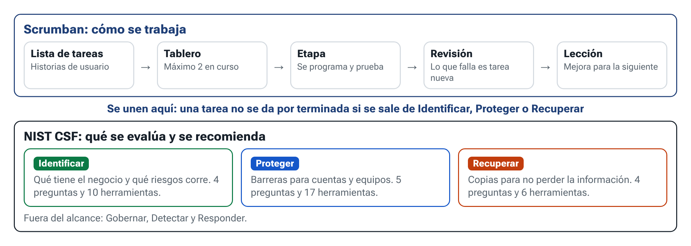
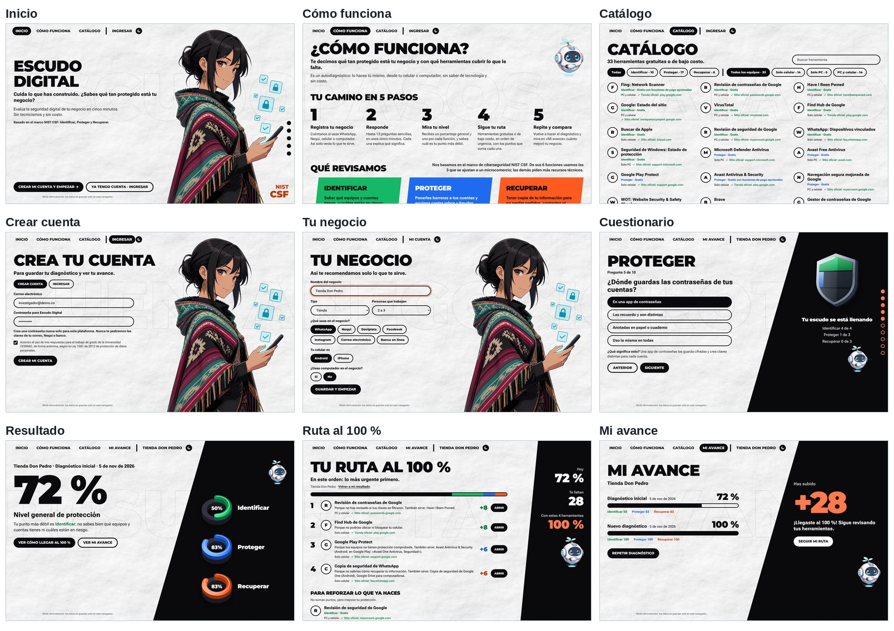
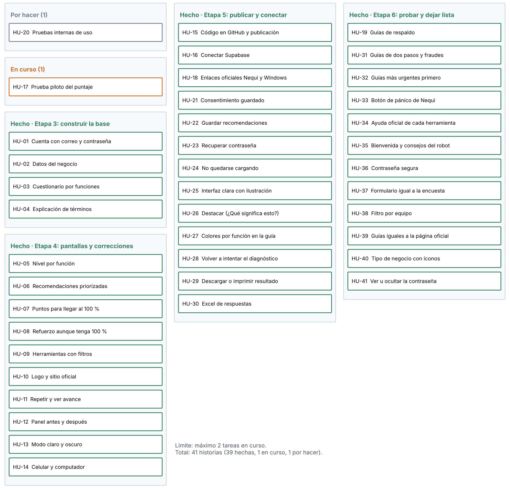
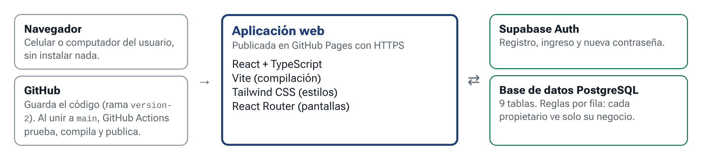
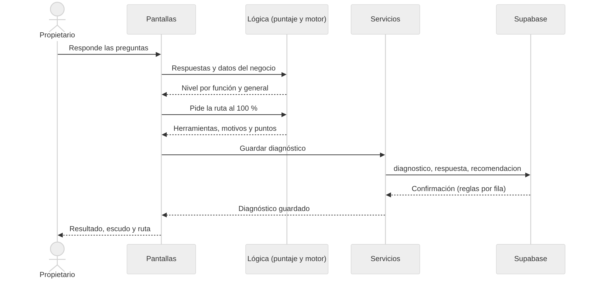
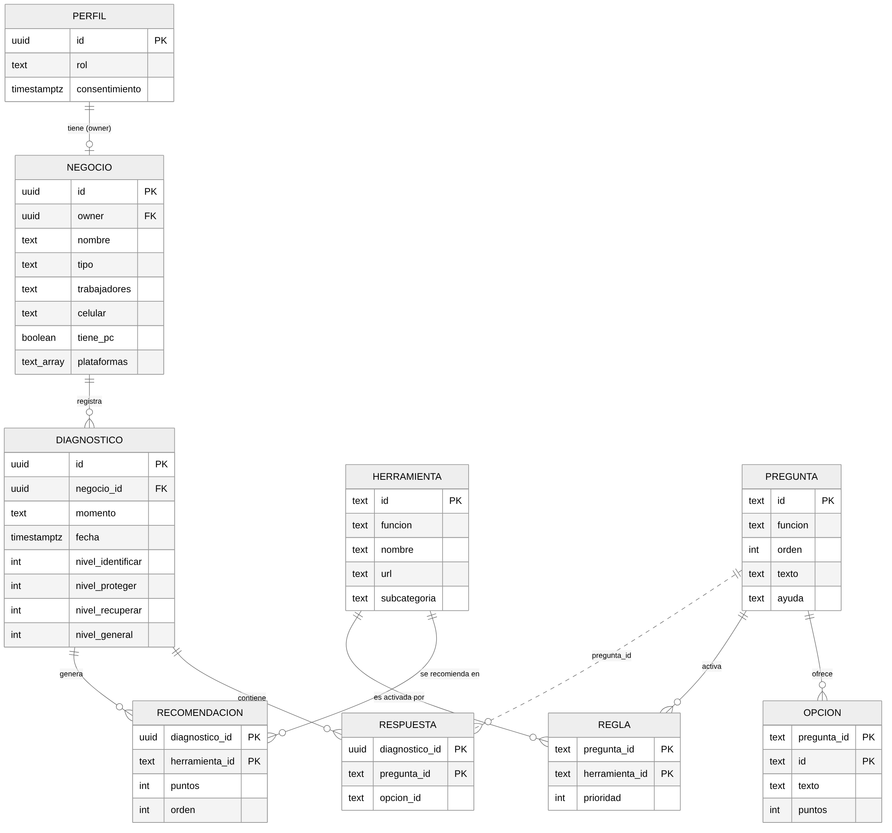
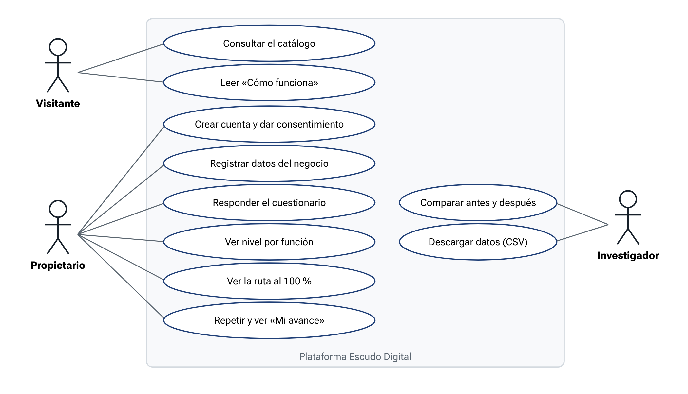
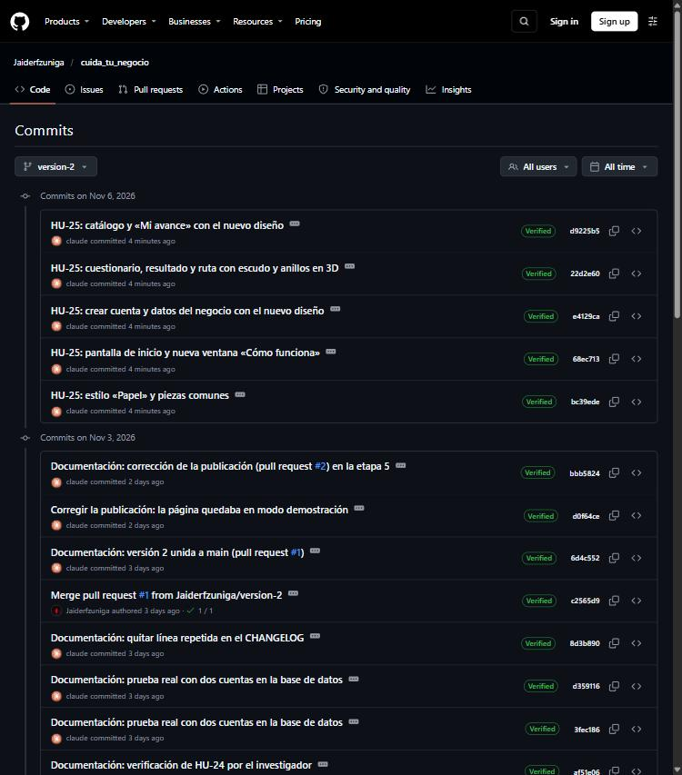

# Objetivo 3: cómo se construyó Escudo Digital

Aquí está, en corto, cómo se hizo la plataforma: de dónde salió, cómo se organizó el trabajo, qué tiene por dentro y qué falta. El detalle completo, con todas las figuras y tablas, está en el informe «Cumplimiento de objetivos» que se entregó a la universidad. Esta página dice lo mismo, pero pensada para quien revisa el código.

**Objetivo 3.** Implementar una plataforma web que, a partir de los resultados del diagnóstico, genere recomendaciones personalizadas de herramientas de ciberseguridad adecuadas al perfil de riesgo de cada microcomercio.

**Cómo va (20 de noviembre de 2026): 90 %.** La plataforma está terminada, publicada y ya la usan negocios reales. Cumple los 17 requerimientos funcionales. Falta la prueba piloto del puntaje (HU-17), las pruebas internas de uso (HU-20) y dos requerimientos no funcionales que quedaron a medias (RNF-05 y RNF-10).

- Web: https://cuida-tu-negocio.vercel.app
- Copia en GitHub Pages: https://jaiderfzuniga.github.io/cuida_tu_negocio/
- Versión actual: 2.7.6 (ver el [historial de cambios](../../CHANGELOG.md))

> Tres palabras que se repiten: un **commit** es un cambio guardado en GitHub; una **rama** es una copia de trabajo del proyecto; un **pull request** es la solicitud para pasar esa copia a la rama principal, que es la que se publica.

## 1. De dónde salió

La plataforma no empezó de cero. Usa lo que dejaron los dos objetivos anteriores:

- **Del objetivo 1 (diagnóstico de 12 microcomercios):** las brechas por función (Identificar 22 %, Proteger 67 % y Recuperar 22 % de respuestas favorables) y las 12 necesidades encontradas (H1 a H12). De ahí salen las preguntas y el orden de las recomendaciones.
- **Del objetivo 2 (catálogo):** las herramientas gratuitas o de bajo costo, clasificadas por función. Hoy son **37**: 10 de Identificar, 21 de Proteger y 6 de Recuperar.
- **De los dos:** 17 requerimientos funcionales (lo que la plataforma hace) y 12 no funcionales (cómo debe ser).

**El primer prototipo.** En septiembre se armó un prototipo en Figma Make llamado «Cuida tu Negocio» (por eso el repositorio se llama así). El 3 de octubre se revisó y tenía problemas de fondo: sus 7 preguntas y 11 herramientas no salían del diagnóstico, no guardaba ningún dato (sin eso no se puede comparar el antes y el después del objetivo 4) y todo el código estaba en un solo archivo. Por eso se hizo una versión nueva desde cero. Del prototipo solo se conservó el recorrido: nombre, preguntas, resultado y herramientas.

| | Prototipo (septiembre) | Escudo Digital (noviembre) |
|---|---|---|
| Preguntas | 7, sin relación con el diagnóstico | 13; cada negocio responde entre 8 y 13 según lo que usa |
| Herramientas | 11 | 37 del catálogo |
| Datos | No guarda nada | Cuentas y base de datos con reglas de acceso |
| Antes y después | No se puede | Guarda cada intento con su fecha |
| Guías | No tiene | 13 guías paso a paso con enlaces oficiales |

## 2. Cómo se organizó el trabajo

Se usaron dos metodologías que hacen cosas distintas:

- **Scrumban** dice *cómo y cuándo* se construye: etapas con revisión al final (de Scrum) y un tablero con máximo 2 tareas en curso (de Kanban). Se eligió porque la plataforma la hizo una sola persona; Scrum completo pide roles y reuniones que no tienen sentido para un equipo de uno. Detalle en [Scrumban](../scrumban/README.md).
- **NIST CSF 2.0** dice *qué* se evalúa y qué se recomienda, solo con Identificar, Proteger y Recuperar. Detalle en [NIST CSF](../nist-csf.md).

### Las seis etapas

El cronograma ponía el inicio el 7 de septiembre, pero el diagnóstico se alargó hasta el 8 de octubre por la disponibilidad de los propietarios, y eso corrió todo lo demás. Las etapas 1 a 4 salieron rápido (30 y 31 de octubre) porque ya estaba listo el diagnóstico, el catálogo y los requerimientos.

| Etapa | Planeado | Real | Qué quedó |
|---|---|---|---|
| 1. Planear cómo se construye | 07/09 – 18/09 | 30/10 | Plan técnico: tecnologías, partes del sistema y 9 tablas |
| 2. Diseñar cómo se ve | 19/09 – 30/09 | 30/10 | Pantallas de muestra antes de programar |
| 3. Construir la base | 01/10 – 15/10 | 30/10 | Catálogo, cuestionario, cálculo del nivel y reglas |
| 4. Armar las pantallas | 16/10 – 30/10 | 30 – 31/10 | 9 pantallas; cuestionario de 18 a 13 preguntas |
| 5. Publicar y conectar | 01/11 – 13/11 | 31/10 – 15/11 | GitHub Pages, Supabase, diseño nuevo y Vercel |
| 6. Probar y dejar lista | 14/11 – 27/11 | 09/11 – en curso | Guías, revisión de seguridad, formulario igual a la encuesta |

Ojo: las etapas 1 a 4 se anotaron en el tablero después de hechas, el 31 de octubre. Sí tuvieron planeación y revisión, pero no se llevaron con el tablero mientras pasaban. Desde la etapa 5 el método se usó a medida que se trabajaba. Lo que pasó en cada etapa, con sus errores y correcciones, está en el [registro de iteraciones](../scrumban/iteraciones.md).

### El cambio de diseño

Entre el 4 y el 6 de noviembre el diseño se cambió por completo porque el estilo inicial («Neón») no convencía. Se vieron varias propuestas y se eligió el estilo actual, con la ilustración de una mujer con ruana. Después se hicieron los wireframes en Figma: bocetos interactivos de todas las pantallas, en computador y celular, en modo claro y oscuro. El cambio fue solo de apariencia: la forma de evaluar y de recomendar siguió igual. El asesor aprobó el diseño el 6 de noviembre.

## 3. El tablero y las historias de usuario

Cada tarea se escribió como historia de usuario («Como…, quiero…, para…») y se movió en el tablero. Hoy son **41 historias: 39 hechas, 1 en curso (HU-17) y 1 por hacer (HU-20)**. La lista completa está en el [backlog](../scrumban/backlog.md).

Al revisarlas para el informe, no todas se podían justificar con una necesidad real: varias se escribieron después, el 31 de octubre, y otras son ajustes pequeños de colores o títulos. Por eso en el informe solo se presentan las que salen de una necesidad del diagnóstico (H1 a H12) o de un requerimiento. Las demás siguen aquí, en el tablero y en el historial, con su número original.

## 4. Qué tiene por dentro

### Tecnologías

Se eligieron herramientas gratuitas, actuales y bien documentadas, que una sola persona pudiera construir y mantener.

| Parte | Tecnología | Para qué |
|---|---|---|
| Interfaz | React 18 + TypeScript | Pantallas y componentes |
| Construcción | Vite | Compila y empaqueta |
| Estilos | Tailwind CSS 4 | Colores, modo claro y oscuro, celular y computador |
| Cuentas y datos | Supabase (PostgreSQL) | Inicio de sesión y base de datos con reglas de acceso por fila |
| Pruebas | Vitest | Revisan solas el cálculo, el motor y las guías |
| Excel del investigador | ExcelJS | Descarga de los datos del panel |
| Publicación | Vercel y GitHub Pages | Publican con HTTPS cada vez que algo llega a `main` |

### Arquitectura

Son tres partes:

1. **La aplicación**, que corre en el navegador. Está separada en capas: pantallas (`src/pages`), lógica (`src/lib`: cálculo y motor), datos (`src/data`: 13 preguntas, 37 herramientas y 13 guías) y servicios (`src/services`: la única capa que habla con la base de datos). Así un error se ubica rápido.
2. **Supabase**, en la nube: cuentas con correo y contraseña y 9 tablas. Cada propietario solo ve su negocio; solo el investigador ve el panel de todos. No hay servidor propio que mantener.
3. **GitHub y la publicación**: los cambios se prueban en la rama `version-2` y, al unirlos a `main` con un pull request, Vercel y GitHub Pages publican solos.

Qué pasa cuando alguien termina el cuestionario:

La base de datos (el detalle de cada campo está en `supabase/migrations/001_esquema.sql`):

Lo que puede hacer cada tipo de usuario:

### Cómo se calcula el nivel

Programado en `src/lib/puntaje.ts`:

1. Cada respuesta vale **2** (lo tiene completo), **1** (a medias o solo lo conoce) o **0** («No» o «No sé»).
2. Se suman los puntos de cada función, contando solo las preguntas que aplican al negocio (por ejemplo, si no tiene computador, esa pregunta no cuenta).
3. Nivel de la función = puntos obtenidos ÷ puntos posibles × 100.
4. Nivel general = promedio de las tres funciones, para que cada una pese lo mismo.

Por qué así: hay un punto intermedio porque en las visitas muchas prácticas estaban a medias; «No sé» vale 0 porque si el dueño no sabe si algo está activo, no se puede dar por hecho; y todas las preguntas pesan igual porque el NIST CSF no fija pesos. El sustento completo está en [sustento del puntaje](sustento-puntaje.md) y la [rúbrica](rubrica-puntaje.md).

### Cómo se arma la recomendación

Programado en `src/lib/motor.ts`, con reglas fijas y **sin inteligencia artificial**:

- Cada respuesta que no tiene el puntaje completo activa la primera herramienta de esa pregunta que sirva en los equipos del negocio (no se recomienda algo de Android a quien tiene iPhone, ni algo de computador a quien no tiene).
- Cada herramienta dice cuántos puntos suma. Toda la ruta suma justo lo que le falta al negocio para llegar al 100 %.
- La ruta empieza por la función más baja y, dentro de ella, por lo que más suma.
- Aunque llegue al 100 %, se muestran hasta dos herramientas de refuerzo por función.

Lo comprobado: las pruebas automáticas confirman que todo «sí» da 100 %, todo «no» da 0 %, que lo que no aplica no cuenta y que la ruta suma exacto lo que falta. Lo que falta comprobar es que el nivel coincida con lo que se ve en el negocio: para eso es la prueba piloto (HU-17).

### Seguridad

El 14 de noviembre se revisó la base de datos, el código y la publicación. No hubo fallas graves: las 9 tablas tienen reglas de acceso, nadie puede darse el rol de investigador, la web solo usa la clave pública de Supabase y las contraseñas se guardan cifradas. Como mejora, la contraseña mínima pasó de 6 a 8 caracteres. La protección contra contraseñas filtradas no se activó porque solo viene en el plan de pago de Supabase.

## 5. Requerimientos

«Hecho» quiere decir que está programado y funcionando, no que ya se validó con los negocios.

**Funcionales: los 17 están hechos.**

| ID | La plataforma debe… | Cómo lo hace |
|---|---|---|
| RF-01 | Tener un cuestionario por funciones | 13 preguntas como máximo |
| RF-02 | Explicar cada término técnico | Explicación en cada pregunta |
| RF-03 | Calcular un nivel por función | Porcentaje de 0 a 100 |
| RF-04 | Mostrar el resultado de forma visual | Escudo y anillos en 3D |
| RF-05 | Recomendar con reglas | Reglas escritas, sin inteligencia artificial |
| RF-06 | Tener un catálogo con filtros | Por función, equipo y búsqueda |
| RF-07 | Ordenar por prioridad | Primero la función más baja |
| RF-08 | Guiar el respaldo y la recuperación | Guías de WhatsApp, celular y computador |
| RF-09 | Recomendar cada cuánto respaldar | Cada guía de Recuperar lo dice |
| RF-10 | Guiar la verificación en dos pasos | WhatsApp, Google, Facebook, Instagram y clave dinámica de Nequi |
| RF-11 | Recomendar gestor de contraseñas | Pregunta y herramientas de Proteger |
| RF-12 | Enseñar a reconocer fraudes | Guía de señales de alerta |
| RF-13 | Recomendar protección básica | Antivirus y actualizaciones |
| RF-14 | Ayudar a revisar equipos y sesiones | Preguntas y herramientas de Identificar |
| RF-15 | Tener preguntas de hábitos | Por ejemplo, dónde guarda sus contraseñas |
| RF-16 | Guardar, repetir, descargar o imprimir | Guarda cada intento y compara |
| RF-17 | Adaptarse a lo que usa el negocio | Filtra preguntas y herramientas |

**No funcionales:**

| ID | La plataforma debe… | Estado |
|---|---|---|
| RNF-01 | Pensarse primero para celular | Hecho; falta probar en equipos de los negocios |
| RNF-02 | Usarse sin ayuda | Por medir en las pruebas de uso |
| RNF-03 | Tener acciones simples, sin tecnicismos | Por medir en las pruebas de uso |
| RNF-04 | Dejar corregir respuestas | Hecho (botón «Anterior») |
| RNF-05 | Leerse bien, en claro y oscuro | A medias; falta medir el contraste |
| RNF-06 | Cargar rápido con datos móviles | Hecho: 98 en celular y 100 en computador en PageSpeed (19/11) |
| RNF-07 | No pedir contraseñas de las cuentas del negocio | Hecho |
| RNF-08 | Informar y pedir consentimiento | Hecho; se guarda la fecha |
| RNF-09 | Abrirse con un enlace | Hecho; Vercel y GitHub Pages con HTTPS |
| RNF-10 | Actualizar el catálogo sin tocar el código | A medias; por decidir con el asesor |
| RNF-11 | Estar en español y con el glosario del proyecto | Hecho |
| RNF-12 | Ser de autoservicio | Por medir en las pruebas de uso |

## 6. Evidencia en GitHub

- Todo el trabajo se hizo en la rama `version-2` y pasó a `main` con **22 pull requests** entre el 2 y el 20 de noviembre, todos revisados y unidos por el investigador.
- Desde la etapa 5, cada historia terminada se sube en su propio commit con su código (por ejemplo, `HU-41: botón para ver u ocultar la contraseña`).
- Cada versión queda explicada en el [historial de cambios](../../CHANGELOG.md).

## 7. Qué falta

1. **Prueba piloto del puntaje (HU-17):** comparar, en la misma visita, el nivel de la plataforma con la lista de chequeo en dos o tres negocios de reserva.
2. **Pruebas internas de uso (HU-20):** revisar que la plataforma se use sin ayuda antes de la validación con los negocios.
3. **RNF-05 y RNF-10:** medir el contraste y decidir con el asesor cómo actualizar el catálogo.

## Autor

Jaider Felipe Matta Zuñiga, Ingeniería de Sistemas, Universidad CESMAG. Asesor: Mg. Luis Arnoby Escobar Hernández. Las decisiones del proyecto, el diseño, las pruebas y la aprobación de cada cambio las hizo el investigador; para escribir código y documentación se usó el apoyo del asistente Claude.
