# Objetivo específico 3: desarrollo de la plataforma «Escudo Digital»

Informe del proceso, las metodologías, el diseño y las evidencias. Actualizado al 5 de noviembre de 2026. El mismo contenido se entrega en Word para el asesor.

## I. INTRODUCCIÓN

Este informe cuenta, en orden y con evidencias, cómo se ha trabajado el objetivo específico 3 desde que se cerraron los objetivos 1 y 2: qué se hizo, en qué fecha, con qué metodologías, qué se subió a GitHub, por qué cambió el diseño y qué falta.

**Objetivo específico 3.** Implementar una plataforma web que, a partir de los resultados del diagnóstico, genere recomendaciones personalizadas de herramientas de ciberseguridad adecuadas al perfil de riesgo de cada microcomercio.

**Estado al 6 de noviembre de 2026: el objetivo está en desarrollo, no terminado.** La plataforma funciona, guarda datos reales y genera recomendaciones por reglas. Falta validar las preguntas con el asesor, corregir dos enlaces, completar las guías de respaldo y hacer las pruebas de uso. De las 25 historias de usuario, 21 están hechas, 1 está en curso y 3 están por hacer.

**Tres palabras que se repiten.** Un *commit* es un cambio guardado en GitHub, con fecha y código propio, como bc39ede. Una *rama* es una copia de trabajo del proyecto. Un *pull request* es la solicitud para unir una rama a la principal, que es la que se publica.

**TABLA I. Estado del objetivo específico 3**

| Parte del objetivo | Cómo va | Evidencia |
|---|---|---|
| Plan técnico, arquitectura y base de datos | Hecho | Sección VII; documento de arquitectura |
| Cuestionario por Identificar, Proteger y Recuperar | Funciona; falta validarlo con el asesor (HU-17) | src/data/preguntas.ts |
| Cálculo del nivel y motor de recomendaciones por reglas | Hecho, con 3 pruebas automáticas | src/lib; tests/motor.test.ts |
| Catálogo de 33 herramientas con filtros | Funciona; faltan 2 enlaces (HU-18) | src/data/catalogo.json |
| Cuentas y base de datos conectadas | Hecho y probado con dos cuentas | Sección V-E |
| Publicación en internet | Hecho. La página pública ya muestra el diseño nuevo | Sección VIII |
| Nuevo diseño (HU-25) | Publicado; falta la revisión del asesor | Sección VI |
| Guías de respaldo y restauración (HU-19) | En curso | Sección IX |
| Pruebas internas de uso, ISO/IEC 25010 (HU-20) | Por hacer | Sección V-F |

## II. PUNTO DE PARTIDA: LO QUE DEJARON LOS OBJETIVOS 1 Y 2

La plataforma no empezó desde una idea suelta. Los dos objetivos anteriores le entregaron el problema que debía atender y las herramientas con las que debía responder (TABLA II). El informe de avances que cierra ambos objetivos se guardó el 30 de octubre de 2026.

**TABLA II. Qué recibió el objetivo 3 de los objetivos anteriores**

| Viene de | Resultado | Cómo se usó en la plataforma |
|---|---|---|
| Objetivo 1 | Diagnóstico de 12 microcomercios. Proteger 67 %, Identificar 22 % y Recuperar 22 % de respuestas favorables. | Las preguntas y la prioridad de las recomendaciones parten de esas brechas. |
| Objetivo 1 | 12 necesidades identificadas (H1 a H12). | De ellas salen buena parte de las historias de usuario. |
| Objetivo 2 | Catálogo final de 34 herramientas clasificadas por función. | La plataforma carga 33. Recuva quedó por fuera porque su licencia gratuita es solo para uso doméstico. |
| Objetivos 1 y 2 | 17 requerimientos funcionales (RF: lo que debe hacer) y 12 no funcionales (RNF: cómo debe ser). | Cada historia de usuario se enlaza con uno de ellos. |

**Antecedente: el prototipo «Cuida tu Negocio».** Antes de esta versión ya existía un prototipo, publicado el 10 y 11 de septiembre (commits 24b2ac2 y 954d303). El 3 de octubre se analizó en un documento técnico que encontró 16 hallazgos: 4 pantallas, 7 preguntas, 11 herramientas y ningún dato guardado. El cuestionario y el catálogo no correspondían del todo a lo investigado y, sin base de datos no era posible comparar el antes y el después que exige el objetivo 4. Por eso se decidió construir de nuevo.

**Por qué se corrieron las fechas.** El cronograma ponía el inicio del objetivo 3 el 7 de septiembre. La aplicación del diagnóstico se extendió hasta el 8 de octubre por la disponibilidad de los propietarios, y eso desplazó el objetivo 2 y, después, el objetivo 3.

## III. LAS DOS METODOLOGÍAS

El proyecto usa dos metodologías que hacen trabajos distintos. **Scrumban** dice cómo se organiza el trabajo. **NIST CSF** dice qué se evalúa y qué se recomienda (Fig. 1).

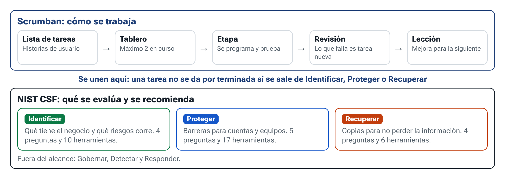

*Fig. 1. Cómo se conectan Scrumban y NIST CSF. Fuente: elaboración propia.*

### A. Scrumban: cómo se organiza el trabajo

Scrumban combina las etapas con revisión de Scrum [1] con el tablero de Kanban [2]. Se eligió porque el desarrollo lo hace una sola persona y necesita un método simple, ordenado y fácil de mostrar. En el proyecto se aplica así:

**TABLA III. ¿Quién hace qué?**

| Persona | Papel | Qué hace |
|---|---|---|
| Jaider Felipe Matta Zuñiga (investigador) | Dueño del producto y desarrollador | Decide qué se hace primero, programa con apoyo de asistentes de inteligencia artificial y prueba la plataforma. |
| Mg. Luis Arnoby Escobar Hernández (asesor) | Revisor | Revisa los avances y valida decisiones importantes, como las preguntas del cuestionario. |
| Propietarios de microcomercios | Usuarios | Son quienes usarán la plataforma en la Fase 4. |

- **Lista de tareas (backlog):** 25 historias de usuario con la forma «Como…, quiero…, para…».
- **Tablero:** tres columnas (Por hacer, En curso y Hecho), con máximo dos tareas en curso.
- **Etapas:** seis, tomadas de las actividades 7, 8 y 9 del cronograma.
- **Revisión:** al terminar se prueba; lo que falla o no gusta se vuelve una tarea nueva.
- **Lección:** cada etapa deja una mejora para la siguiente.

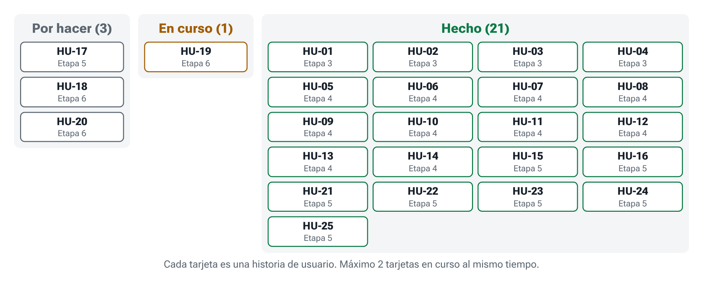

*Fig. 2. Tablero del proyecto al 5 de noviembre de 2026. Fuente: elaboración propia.*

**¿Cuándo una tarea está terminada?** Cuando cumple cinco condiciones: hace lo pedido sin salirse de Identificar, Proteger y Recuperar; funciona y pasan las pruebas automáticas; se probó en celular y computador, en claro y oscuro; se probaron los casos extremos (todo «sí» y todo «no»), y quedó en GitHub y en el historial de cambios.

**Lo que hay que decir con claridad.** El tablero, la lista de historias y las fechas por etapa se escribieron el 31 de octubre, mirando hacia atrás. Las etapas 1 a 4 sí tuvieron planeación, revisión y corrección, pero no se llevaron con ese formato mientras ocurrían. Desde la etapa 5, el método se aplica mientras se trabaja. El rediseño de la sección VI es el ejemplo más claro.

### B. NIST CSF: qué se evalúa y qué se recomienda

Del marco NIST CSF 2.0 [3] se usan solo tres de sus seis funciones. Gobernar, Detectar y Responder quedan fuera porque exigen una madurez técnica que un microcomercio no tiene. La plataforma no hace monitoreo en tiempo real, detección de intrusiones ni respuesta automatizada a incidentes.

**TABLA IV. Cómo aplica la plataforma cada función del NIST CSF**

| Función | Preguntas | Herramientas | Dónde se ve |
|---|---|---|---|
| Identificar | 4: filtración de claves, sesiones abiertas, enlaces raros y ubicar el celular | 10 (ID.AM-01, ID.AM-02, ID.RA-01 e ID.RA-03) | Verde. Franja de arriba del escudo y primer anillo |
| Proteger | 5: contraseñas, PIN de WhatsApp, verificación en dos pasos, Nequi y antivirus | 17 (PR.AA, PR.AT, PR.DS y PR.PS) | Azul. Franja del medio y segundo anillo |
| Recuperar | 4: copia de WhatsApp, copia del celular, archivos en la nube y saber recuperar | 6 (PR.DS-11 y RC.RP-03) | Naranja. Franja de abajo y tercer anillo |

La Fig. 3 sigue una pregunta real desde que aparece en pantalla hasta que se convierte en recomendación. Las recomendaciones salen de reglas escritas y verificables, sin inteligencia artificial.

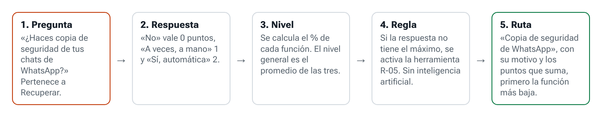

*Fig. 3. Del NIST CSF a la recomendación: un ejemplo real de Recuperar. Fuente: elaboración propia.*

## IV. LÍNEA DE TIEMPO

La Fig. 4 reúne el proceso completo. Las horas son de Colombia y salen de GitHub y de la fecha de guardado de los archivos. GitHub muestra a los visitantes la hora universal, así que los envíos del 5 de noviembre por la noche pueden aparecer con fecha 6.

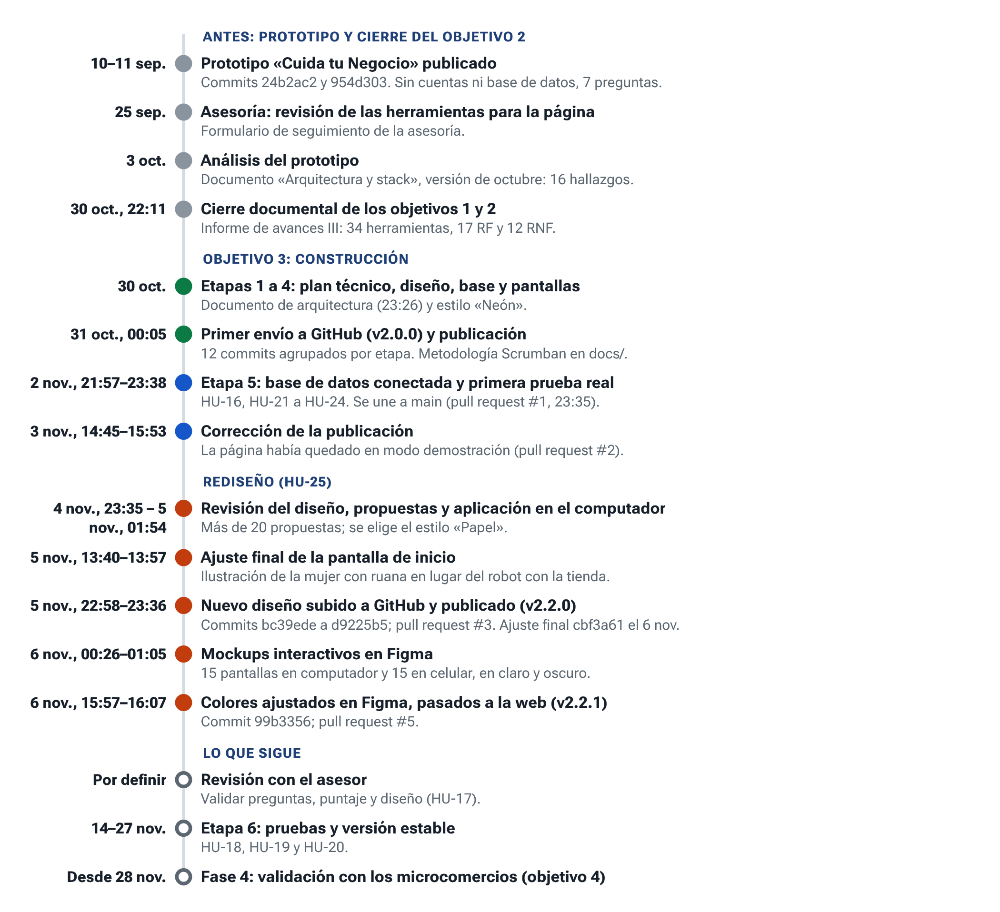

*Fig. 4. Línea de tiempo del objetivo 3 y sus antecedentes. Fuente: elaboración propia.*

La Fig. 5 compara lo planeado con lo que quedó registrado. Las etapas 1 a 4 se registraron entre el 30 y el 31 de octubre: después de lo planeado y en muy pocos días. La etapa 5 empezó antes de lo previsto y la etapa 6 sigue dentro de su plazo.

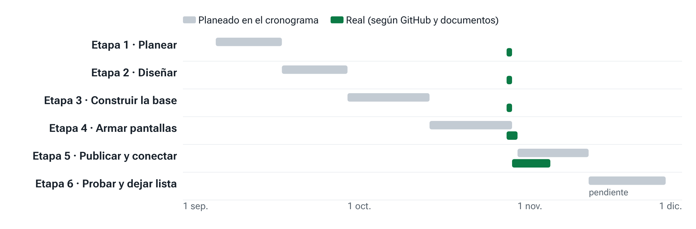

*Fig. 5. Fechas planeadas y fechas reales de cada etapa. Fuente: elaboración propia.*

**TABLA V. Fechas de cada etapa**

| Etapa | Actividad | Planeado | Real | ¿Cómo va? |
|---|---|---|---|---|
| 1. Planear cómo se construye | 7 | 07/09 – 18/09/2026 | 30/10/2026 | Hecho |
| 2. Diseñar cómo se ve | 7 | 19/09 – 30/09/2026 | 30/10/2026 | Hecho |
| 3. Construir la base | 8 | 01/10 – 15/10/2026 | 30/10/2026 | Hecho |
| 4. Armar las pantallas y corregir | 8 | 16/10 – 30/10/2026 | 30 – 31/10/2026 | Hecho |
| 5. Publicar y conectar | 9 | 01/11 – 13/11/2026 | 31/10 – 05/11/2026 | En curso |
| 6. Probar y dejar lista | 9 | 14/11 – 27/11/2026 | Sin iniciar | Por hacer |

## V. QUÉ SE HIZO EN CADA ETAPA

### A. Etapa 1: Planear cómo se construye (hecho)

- **Qué se buscaba:** decidir con qué tecnologías se hace la plataforma, cómo se organiza y qué datos guarda.
- **Qué se entregó:** el documento «Arquitectura y stack tecnológico», de 11 páginas, guardado el 30 de octubre a las 23:26.
- **Qué se corrigió:** el prototipo anterior no servía de base; por eso se empezó un proyecto nuevo.
- **Qué se aprendió:** planear antes de programar evitó repetir los errores del prototipo.

### B. Etapa 2: Diseñar cómo se ve (hecho)

- **Qué se buscaba:** dibujar las pantallas antes de programar.
- **Qué se entregó:** 11 pantallas de muestra con el estilo «Neón».
- **Qué se corrigió:** el primer diseño no gustó y se rehízo. El investigador pidió mostrar cómo llegar al 100 %, poner el logo de cada herramienta y agregar dibujos en 3D.
- **Qué se aprendió:** corregir un dibujo es más rápido que corregir código.

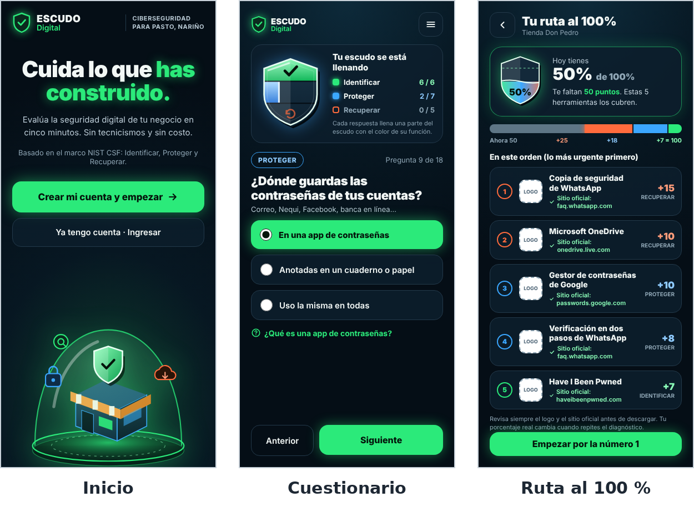

*Fig. 6. Pantallas de muestra aprobadas en la etapa 2. Fuente: elaboración propia.*

### C. Etapa 3: Construir la base (hecho)

- **Historias:** HU-01, HU-02, HU-03 y HU-04.
- **Qué se entregó:** el proyecto con el catálogo, el cuestionario, el cálculo del puntaje y las reglas de recomendación.
- **Evidencia en GitHub:** commits 8f4d84c, f428e4b, ede64af y 4c5e831.
- **Qué se corrigió:** se crearon 3 pruebas automáticas que revisan el cálculo.
- **Qué se aprendió:** guardar las preguntas y las herramientas aparte facilita cambiarlas.

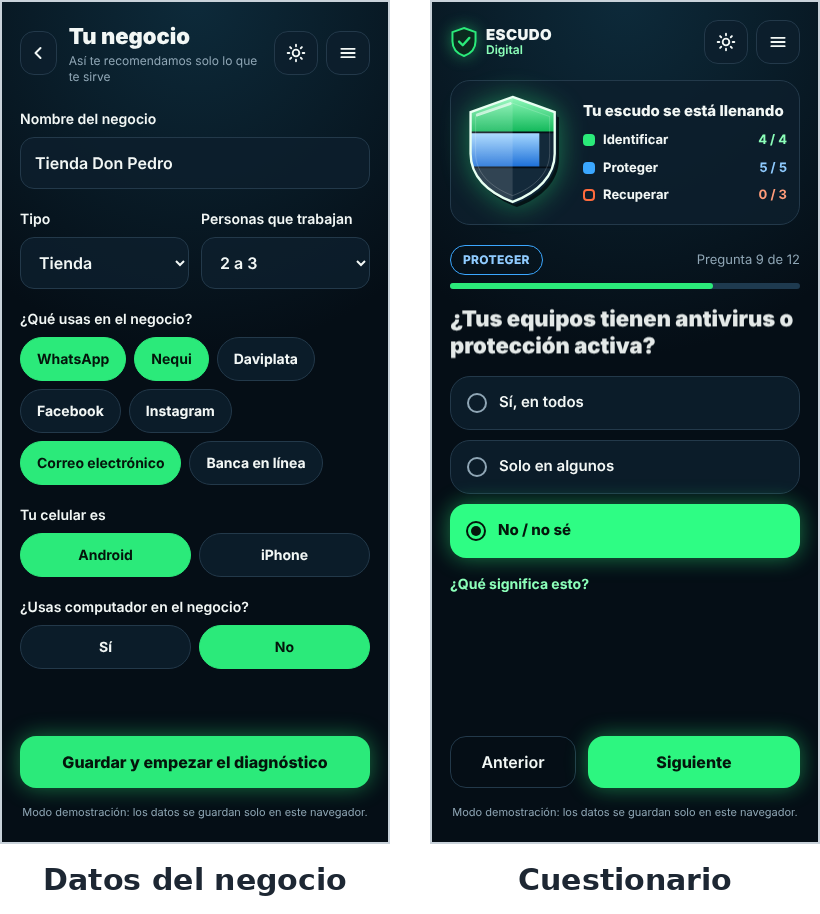

*Fig. 7. Primeras pantallas funcionando en la etapa 3. Fuente: elaboración propia.*

### D. Etapa 4: Armar las pantallas y corregir (hecho)

- **Historias:** HU-05 a HU-14.
- **Qué se entregó:** 9 pantallas funcionando. El investigador pidió porcentajes con animación, un cuestionario más corto (de 18 a 13 preguntas), filtro por celular o computador, herramientas aunque se saque 100 % y diseño para PC y celular.
- **Evidencia en GitHub:** commits 5713fa0 y 1ddd3bc.
- **Qué se corrigió:** al responder todo «sí», la plataforma no recomendaba nada. Se corrigió y se agregó una prueba para que no vuelva a pasar.
- **Qué se aprendió:** siempre hay que probar los casos extremos.

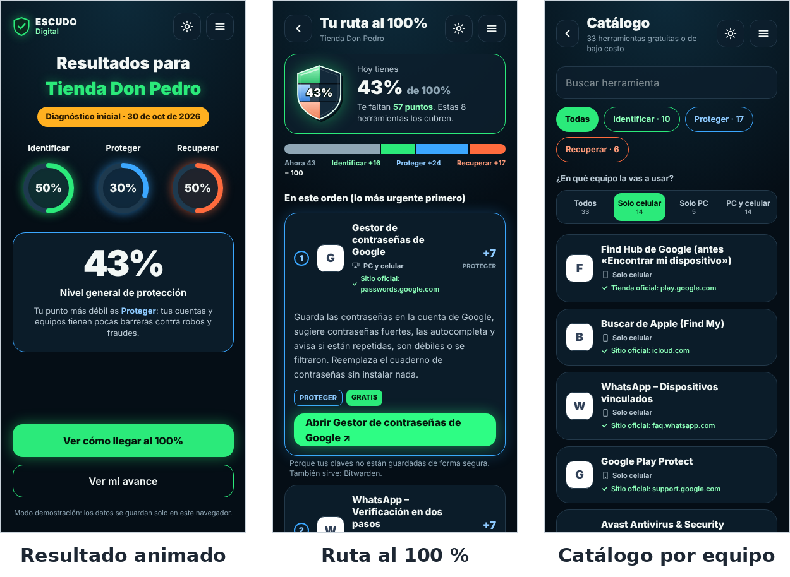

*Fig. 8. Pantallas con las correcciones de la etapa 4, en el celular. Fuente: elaboración propia.*

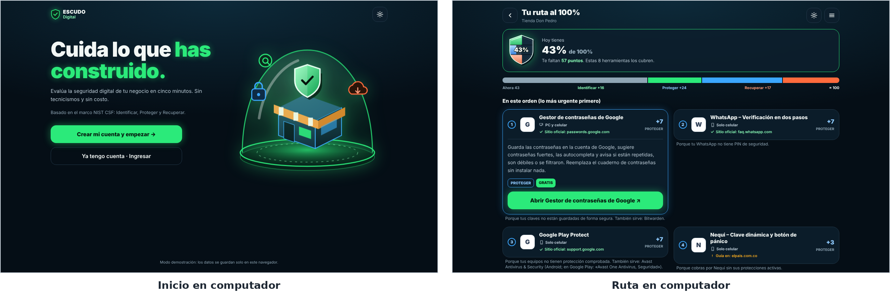

*Fig. 9. La misma versión en el computador. Fuente: elaboración propia.*

### E. Etapa 5: Publicar y conectar (en curso)

- **Historias:** HU-15, HU-16, HU-21, HU-22, HU-23, HU-24 y HU-25 (hechas) y HU-17 (por hacer).
- **31 de octubre:** el código sube a GitHub, separado por partes, y se publica en GitHub Pages (commit 834fa3f).
- **2 de noviembre:** se conecta la base de datos Supabase con 9 tablas, 33 herramientas, 13 preguntas, 40 opciones y 29 reglas. Se guarda la fecha del consentimiento y las recomendaciones, y se agrega la opción de crear una contraseña nueva.
- **2 de noviembre, primer error real:** al probar con su cuenta, el investigador encontró que la plataforma se quedaba «cargando» y luego en blanco (HU-24). Se corrigió y él confirmó que ya funcionaba. La versión 2 se unió a la rama principal (pull request #1).
- **3 de noviembre, segundo error real:** al entrar desde otro dispositivo notó que la página pública había quedado en «modo demostración». La causa estaba en el flujo de publicación. Se corrigió con el pull request #2.
- **Qué se aprendió:** cada historia se sube por separado y cada actualización de la carpeta local debe copiar el código completo; un archivo viejo causó otro error.

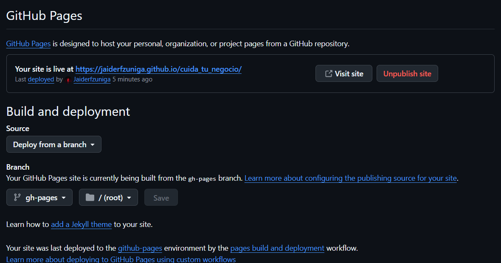

*Fig. 10. Plataforma publicada en GitHub Pages. Fuente: captura de la configuración del repositorio.*

El 2 de noviembre se simularon dos propietarios de prueba, que luego se borraron, y después el investigador probó con dos cuentas reales (TABLA VI).

**TABLA VI. Prueba de la base de datos**

| Qué se probó | Resultado esperado | Resultado |
|---|---|---|
| El propietario 1 registra su negocio, un diagnóstico, respuestas y una recomendación | Todo se guarda | Cumple |
| Al registrarse con la casilla marcada se guarda la fecha del consentimiento | Fecha guardada | Cumple |
| El propietario 2 intenta ver el negocio y el diagnóstico del propietario 1 | No ve nada (0 registros) | Cumple |
| Cualquier usuario consulta el catálogo | Ve las 33 herramientas | Cumple |
| Revisión automática de seguridad de Supabase | Sin alertas graves | Cumple (1 aviso menor justificado) |
| Prueba real con dos cuentas: diagnóstico inicial y de seguimiento | Se guardan con sus respuestas y recomendaciones | Cumple (43 % → 88 %; 24 respuestas y 17 recomendaciones) |

### F. Etapa 6: Probar y dejar lista (por hacer)

- **Planeada:** del 14 al 27 de noviembre de 2026.
- **Historias:** HU-18 (enlaces oficiales), HU-19 (guías de respaldo) y HU-20 (pruebas de uso con base en ISO/IEC 25010 [4]).
- **Entrega esperada:** una versión estable para la Fase 4.

## VI. EL CAMBIO DE DISEÑO (HU-25)

### A. Por qué se cambió

El 4 de noviembre, al revisar la plataforma ya publicada, el investigador dijo que el diseño «Neón» no lo convencía y buscó referencias como raycast.com y resend.com. No quería un escudo enorme como protagonista. Esta es una decisión del investigador en su revisión: **todavía no hay evidencia de que el diseño nuevo sea mejor para los propietarios.** Eso se medirá con las pruebas de la etapa 6 y la validación del objetivo 4.

El cambio siguió el ciclo de Scrumban: la revisión produjo una tarea nueva (HU-25), se mostraron propuestas antes de programar, se aplicó primero en el computador del investigador y solo subió a GitHub cuando él lo pidió (Fig. 11).

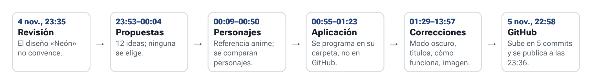

*Fig. 11. El rediseño como un ciclo de Scrumban. Fuente: elaboración propia.*

### B. Cómo se llegó al diseño final

El proceso tomó dos sesiones. La TABLA VII resume las decisiones. Las horas son aproximadas y salen de las imágenes generadas y de los archivos que envió el investigador.

**TABLA VII. Cronología de las decisiones de diseño**

| Fecha y hora | Qué se mostró o se hizo | Qué decidió el investigador |
|---|---|---|
| 04/11, 23:35–23:47 | Revisión del repositorio, sin cambiar nada, y capturas de la versión vigente. | El diseño actual no lo convence. |
| 04/11, 23:53–05/11, 00:04 | 12 propuestas de pantalla inicial (Fig. 12). | Ninguna: «no un escudo enorme». |
| 05/11, 00:09–00:14 | Una figura de Pasto (volcán e iglesias) y un cuy con escudo, sobre una página de referencia en estilo anime que él envió. | Le gusta la composición; el cuy no lo convence. |
| 00:21–00:26 | Personajes en estilo anime que representan la plataforma. | Elige por ahora a la mujer con ruana. |
| 00:31–00:50 | Más personajes y mascota robot. | Se queda con el robot. Pide «Microcomercio» en el letrero y la lista Identificar, Proteger y Recuperar. |
| 00:54–00:55 | Muestra de todas las ventanas con el robot. | Pide anillos de resultado en 3D con 50 %, 67 % y 67 %, logos originales y escudo en 3D. |
| 01:07–01:23 | Se aplica en su carpeta local, sin subir a GitHub. | «Primero local; si quedó bien, a GitHub». |
| 01:29–01:34 | Propuesta para explicar mejor «Cómo funciona». | La aprueba. |
| 01:39–01:54 | Ajustes del modo oscuro y de los títulos. | Fondo más oscuro y sin textura, porque se veía pixelado. Títulos en naranja. |
| 13:40–13:57 | Cambio de la imagen principal. | El robot con la tienda se ve infantil: usa a la mujer con ruana y quita la firma «Hecho en Pasto». |
| 22:41–22:58 | Se comprueba y se sube a GitHub. | Pide subirlo y documentar el proceso. |
| 05/11, 23:36 | Une el pull request #3 y la página pública pasa al diseño nuevo. | Lo publica antes de la revisión con el asesor. |
| 06/11, 00:07–00:10 | Último ajuste, subido a GitHub (commit cbf3a61). | «Tu negocio» también va en naranja en modo oscuro. |

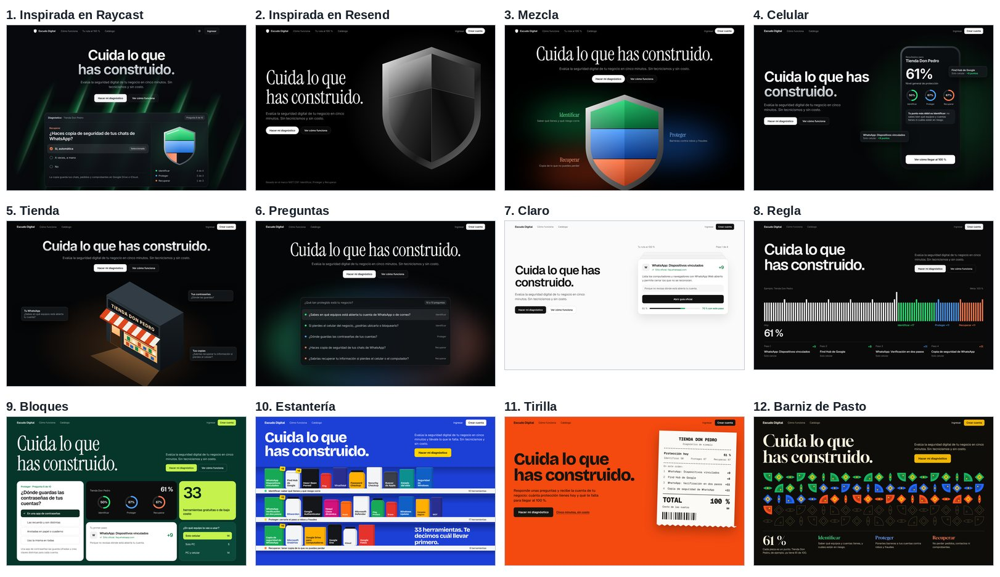

*Fig. 12. Primeras 12 propuestas de pantalla inicial (ninguna elegida). Fuente: elaboración propia.*

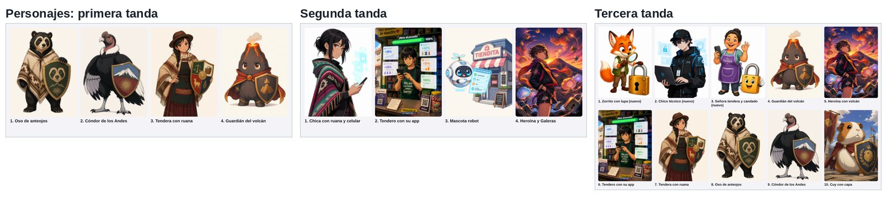

*Fig. 13. Personajes propuestos, generados con inteligencia artificial. Fuente: elaboración propia.*

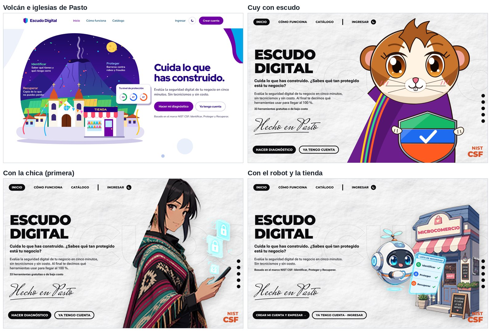

*Fig. 14. Propuestas de pantalla inicial con figura o personaje. Fuente: elaboración propia.*

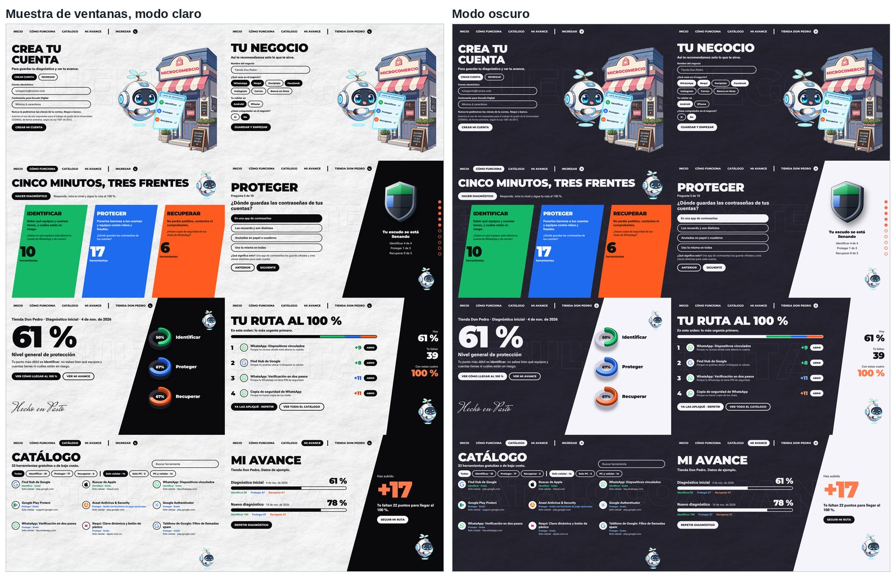

*Fig. 15. Muestra de ventanas con la mascota, antes de programar. Fuente: elaboración propia.*

La página de referencia en estilo anime no se reproduce aquí porque usa un personaje con derechos de autor. Se tomó de ella la composición (título grande, palabra de fondo y panel diagonal), no el personaje.

### C. Antes y ahora

El «antes» es la versión del commit bbb5824 (v2.1.3) y el «ahora» la del commit cbf3a61 (v2.2.0). Todas las capturas se tomaron en modo demostración, con datos de ejemplo.

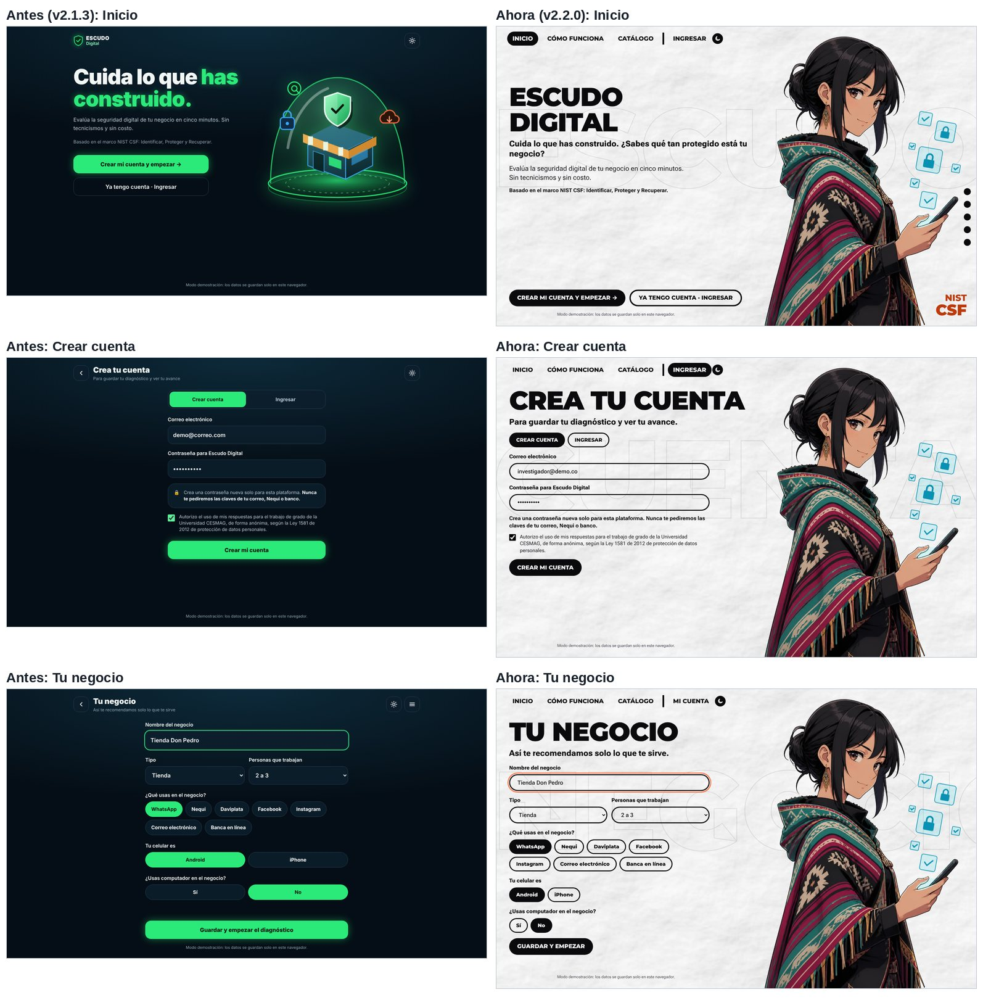

*Fig. 16. Antes y ahora: Inicio, Crear cuenta y Tu negocio. Fuente: elaboración propia.*

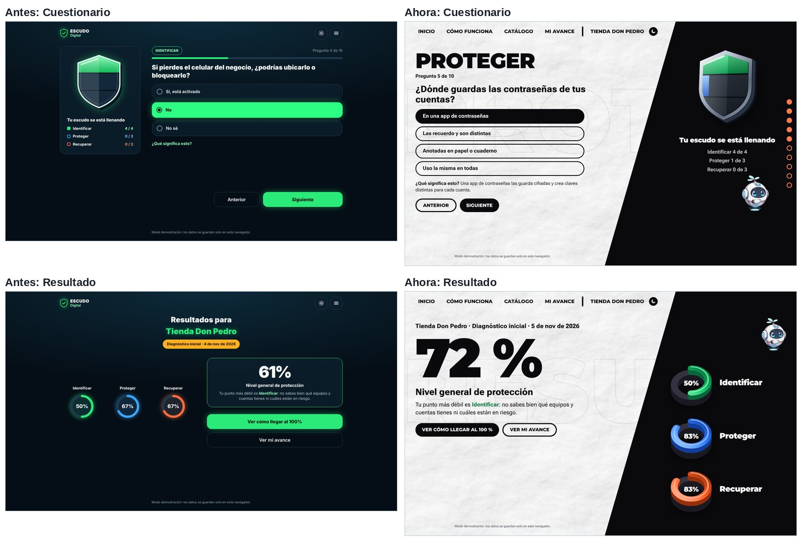

*Fig. 17. Antes y ahora: Cuestionario y Resultado. Fuente: elaboración propia.*

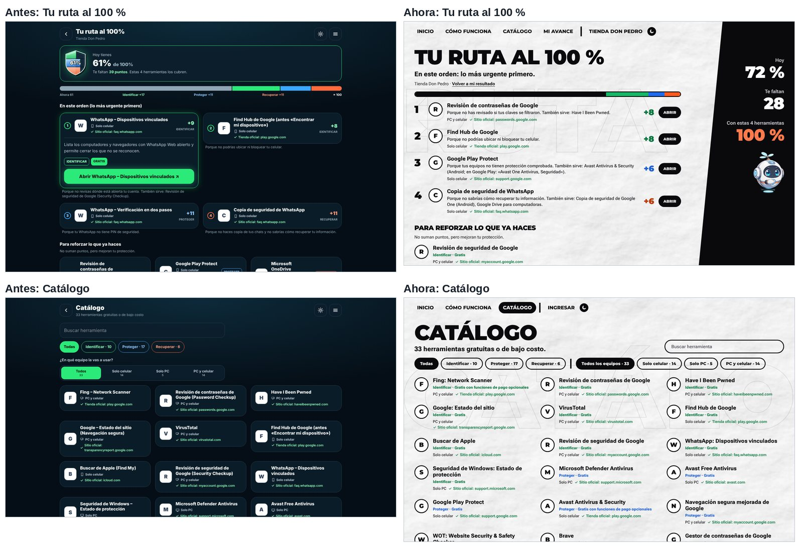

*Fig. 18. Antes y ahora: Tu ruta al 100 % y Catálogo. Fuente: elaboración propia.*

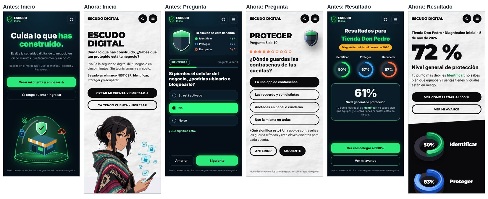

*Fig. 19. Antes y ahora en el celular. Fuente: elaboración propia.*

**Sobre los logos.** En las capturas del «ahora» los logos aparecen como una letra porque el equipo de prueba no tenía acceso al servicio que los entrega; así se comporta la plataforma cuando no carga un logo. La Fig. 20 muestra el catálogo público con el diseño nuevo, el 6 de noviembre: cargaron los 33 logos.

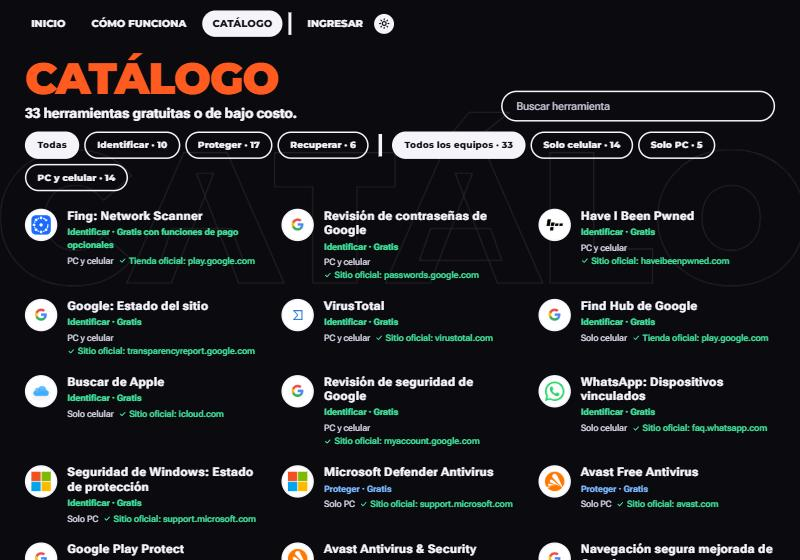

*Fig. 20. Catálogo publicado con el diseño nuevo y los logos originales. Fuente: captura de la página pública, 6 de noviembre de 2026.*

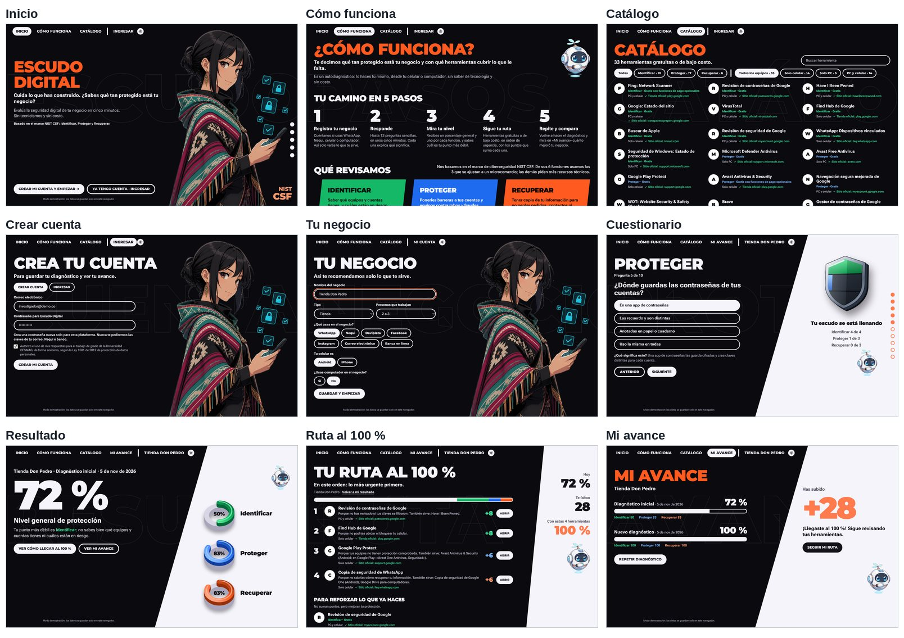

*Fig. 21. Versión 2.2.0 en modo oscuro. Fuente: elaboración propia.*

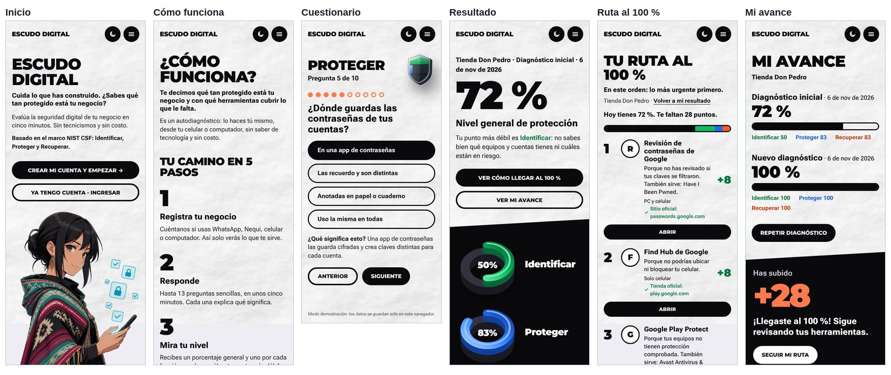

*Fig. 22. Versión 2.2.0 en el celular. Fuente: elaboración propia.*

### D. Qué cambió y qué no

El cambio tocó 22 archivos de la interfaz. Las carpetas de lógica, datos, servicios y base de datos, y las pruebas, no tienen ningún cambio entre las dos versiones. **La plataforma evalúa y recomienda exactamente igual; cambió cómo se ve.**

**TABLA VIII. Qué cambió y qué se mantuvo en la versión 2.2.0**

| Cambió | No cambió |
|---|---|
| Estilo: fondo de papel en modo claro y fondo plano en oscuro, letras Montserrat y Roboto Flex, botones redondeados y panel diagonal. | Las 13 preguntas y su redacción. |
| Pantalla de inicio con los textos del investigador y la ilustración de la mujer con ruana. | La forma de calcular el puntaje. |
| Ventana nueva: «Cómo funciona». | Las reglas de recomendación. |
| Escudo y anillos en 3D, y mascota pequeña. | El catálogo de 33 herramientas. |
| La explicación de cada pregunta se ve siempre, sin tocar un botón. | La base de datos y sus reglas de acceso. |
| «Mi avance» muestra todos los diagnósticos y cuánto subió el negocio. | Las cuentas con correo y contraseña. |

**Pruebas hechas:** compilación sin errores, 3 pruebas automáticas y un recorrido automático en modo demostración por las pantallas, en claro y oscuro, en computador y celular, sin errores ni contenido desbordado. El investigador lo revisó en su computador. **Falta:** la revisión del asesor y las pruebas con usuarios.

### E. Uso de inteligencia artificial en esta etapa

- **Claude** [5]: apoyo en programación, pruebas y documentación. El investigador revisa los resultados y responde por el contenido.
- **Canva** [6] **y Google Gemini** [7]: generación de los personajes y de las imágenes en alta calidad. Las imágenes finales se recortaron y los recuadros con candados se dibujaron aparte.
- **La plataforma no usa inteligencia artificial** para diagnosticar ni recomendar. Esa restricción no cambió.

## VII. PRODUCTOS DE ANÁLISIS Y DISEÑO

Estos son los productos que pide la orientación institucional para el desarrollo. Cada uno refleja la versión 2.2.0. No aplica evidencia de Google Colab porque el proyecto no usa cuadernos de datos.

### A. ¿Qué está diseñado, prototipado, desarrollado y validado?

**TABLA IX. Estado de cada producto**

| Producto | Diseñado | Prototipado | Desarrollado | Validado |
|---|---|---|---|---|
| Cuestionario | Sí | Sí | Sí | Pendiente con el asesor (HU-17) |
| Puntaje y motor de reglas | Sí | No aplica | Sí | Pruebas automáticas; falta con usuarios |
| Catálogo | Sí | Sí | Sí | Herramientas en el objetivo 2; faltan 2 enlaces |
| Cuentas y base de datos | Sí | No aplica | Sí | Prueba con dos cuentas |
| Diseño «Papel» | Sí | Sí | Sí | Revisado por el investigador; falta asesor y usuarios |
| Guías de respaldo | Parcial | No | En curso | No |
| Pruebas de uso ISO/IEC 25010 | Por diseñar | No aplica | No | No |

### B. Historias de usuario

Cada historia nace de una fuente concreta: un hallazgo del diagnóstico, el catálogo, el diseño de la investigación, el plan técnico o una revisión. Por ejemplo, 10 de 12 negocios venden por WhatsApp y cobran por Nequi (H7); eso produjo el requisito RF-17 y la historia HU-02.

**TABLA X. Historias de usuario**

| N.º | Lo que pide el usuario | De dónde salió | Etapa | ¿Cómo va? |
|---|---|---|---|---|
| HU-01 | Como propietario, quiero crear una cuenta con correo y contraseña para guardar mis diagnósticos. | Arquitectura: seguimiento antes/después → RF-16, RNF-08 | 3 | Hecho |
| HU-02 | Como propietario, quiero registrar los datos de mi negocio (plataformas y equipos) para recibir solo lo que me sirve. | H7: operan con pocas plataformas → RF-17 | 3 | Hecho |
| HU-03 | Como propietario, quiero responder un cuestionario corto organizado por Identificar, Proteger y Recuperar. | H1, H2 y encuesta pre-test → RF-01, RF-15 | 3 | Hecho |
| HU-04 | Como propietario, quiero una explicación sencilla de cada término técnico. | H1 y H9: sin formación previa → RF-02 | 3 | Hecho |
| HU-05 | Como propietario, quiero ver mi nivel por función y un escudo que se llena, para entender mi resultado. | H8: quieren orientación → RF-03, RF-04 | 4 | Hecho |
| HU-06 | Como propietario, quiero recomendaciones explicadas («porque…») y ordenadas por prioridad. | H8 y H12: sin personal técnico → RF-05, RF-07 | 4 | Hecho |
| HU-07 | Como propietario, quiero saber cuántos puntos me suma cada herramienta para llegar al 100 %. | Revisión del investigador (30/10) → RF-05, RF-07 | 4 | Hecho |
| HU-08 | Como propietario con 100 %, quiero que igual me recomienden herramientas para mantener mi protección. | Revisión del investigador (30/10) → RF-05 | 4 | Hecho |
| HU-09 | Como propietario, quiero consultar el catálogo y filtrarlo por función y por equipo (celular, PC o ambos). | OE2 y revisión del investigador → RF-06 | 4 | Hecho |
| HU-10 | Como propietario, quiero ver el logo y el sitio oficial de cada herramienta para saber que es legítima. | Revisión del investigador (30/10) → RF-06 | 4 | Hecho |
| HU-11 | Como propietario, quiero repetir el diagnóstico y ver mi avance antes y después. | Diseño pre-test / post-test → RF-16 | 4 | Hecho |
| HU-12 | Como investigador, quiero un panel con el comparativo pre/post de cada negocio y descargar los datos. | Diseño pre-test / post-test (OE4) → Objetivo 4 | 4 | Hecho |
| HU-13 | Como usuario, quiero cambiar entre modo claro y oscuro. | Decisión del investigador → RNF-05 | 4 | Hecho |
| HU-14 | Como usuario, quiero usar la plataforma en el celular y en el computador. | H7 y revisión del investigador → RNF-01 | 4 | Hecho |
| HU-15 | Como investigador, quiero el código en GitHub y la plataforma publicada en un enlace. | Revisión del investigador (31/10) → RNF-09 | 5 | Hecho |
| HU-16 | Como investigador, quiero conectar la base de datos Supabase en el sitio publicado. | Arquitectura (Supabase) → RF-16 | 5 | Hecho |
| HU-17 | Como investigador, quiero validar con el asesor la redacción y el puntaje de las preguntas. | Validez del instrumento → Validez del instrumento | 5 | Por hacer |
| HU-18 | Como propietario, quiero que los enlaces de Nequi (P-18) y Windows Update (P-33) lleven a sitios oficiales. | Revisión del catálogo (OE2) → RF-06 | 6 | Por hacer |
| HU-19 | Como propietario, quiero guías paso a paso para respaldar y recuperar mi información. | H3 y H4: Recuperar crítica → RF-08, RF-09 | 6 | En curso |
| HU-20 | Como investigador, quiero pruebas internas de usabilidad basadas en ISO/IEC 25010 antes de aplicar la plataforma. | ISO/IEC 25010 (OE4) → RNF-02, RNF-12 | 6 | Por hacer |
| HU-21 | Como investigador, quiero que quede guardada la fecha en que cada propietario aceptó el uso de sus datos. | Revisión del código (02/11) → RNF-08 (Ley 1581) | 5 | Hecho |
| HU-22 | Como investigador, quiero que se guarden las herramientas que la plataforma recomendó en cada diagnóstico, para analizarlas en el objetivo 4. | Revisión del código (02/11) → RF-05, Objetivo 4 | 5 | Hecho |
| HU-23 | Como propietario, quiero crear una contraseña nueva si olvidé la mía. | Revisión del código (02/11) → RF-16 | 5 | Hecho |
| HU-24 | Como propietario, quiero que la plataforma no se quede «cargando» después de iniciar sesión. | Prueba del investigador (02/11) → RNF-02 | 5 | Hecho |
| HU-25 | Como propietario, quiero una interfaz clara y cercana, con una ilustración y un diseño que se entienda fácil. | Revisión del investigador (04–05/11) → RNF-05 | 5 | Hecho |

### C. Arquitectura por niveles

**Nivel 0.** La plataforma vista desde afuera: quién la usa y con qué servicios se comunica (Fig. 23).

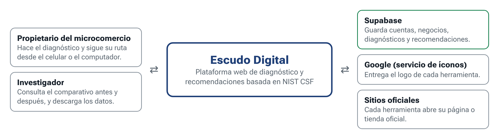

*Fig. 23. Arquitectura, nivel 0. Fuente: elaboración propia.*

**Nivel 1.** Las partes del sistema (Fig. 24). La plataforma se ejecuta en el navegador y se comunica con Supabase por HTTPS; no hay un servidor propio que mantener. Se publica en GitHub Pages [8]; el documento de octubre decía Vercel.

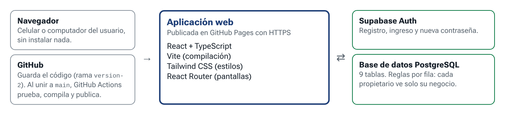

*Fig. 24. Arquitectura, nivel 1. Fuente: elaboración propia.*

**Nivel 2.** Las cinco capas del código (Fig. 25). Cada capa usa la de abajo, de modo que un error se puede ubicar en una carpeta concreta.

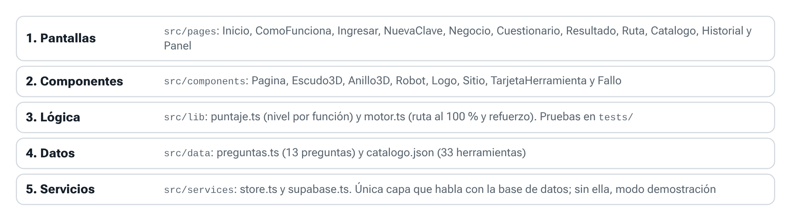

*Fig. 25. Arquitectura, nivel 2: capas de la aplicación. Fuente: elaboración propia.*

### D. Inventario del stack tecnológico

**TABLA XI. Stack tecnológico con versiones instaladas**

| Parte | Tecnología | Versión | Para qué se usa |
|---|---|---|---|
| Interfaz | React [9] | 18.3.1 | Pantallas y componentes |
| Lenguaje | TypeScript [10] | 5.6.3 | Detecta errores antes de ejecutar |
| Construcción | Vite [11] | 5.4.21 | Compila la aplicación |
| Estilos | Tailwind CSS [12] | 4.3.3 | Colores, letras, modo oscuro y adaptación a pantallas |
| Navegación | React Router [13] | 6.30.6 | Rutas entre pantallas |
| Base de datos y cuentas | Supabase [14] (cliente) | 2.118.0 | PostgreSQL, autenticación y reglas de acceso por fila |
| Pruebas | Vitest | 2.1.9 | Pruebas automáticas del cálculo y del motor |
| Publicación | GitHub Pages y GitHub Actions | Servicio | Publica cada cambio que llega a main |
| Control de versiones | Git y GitHub | Servicio | Historial, ramas y pull requests |

### E. Diagramas UML

**Casos de uso.** Qué puede hacer cada tipo de usuario (Fig. 26).

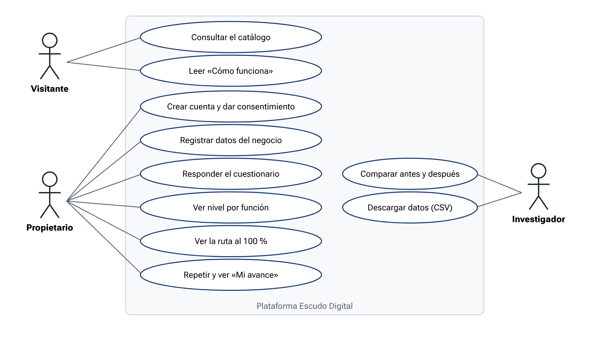

*Fig. 26. Diagrama de casos de uso. Fuente: elaboración propia.*

**Secuencia.** Qué pasa cuando un propietario termina el cuestionario (Fig. 27).

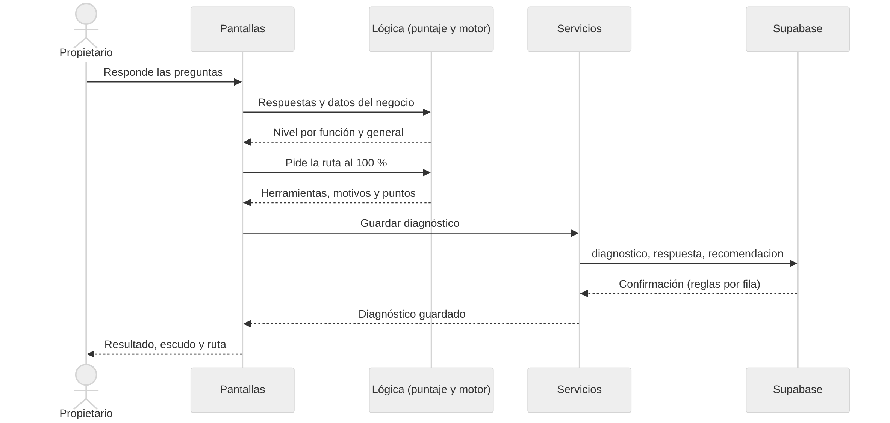

*Fig. 27. Diagrama de secuencia del diagnóstico. Fuente: elaboración propia.*

**Clases.** Los datos y la lógica principales. El código está escrito con funciones y tipos, no con clases; el diagrama representa esos tipos y funciones (Fig. 28).

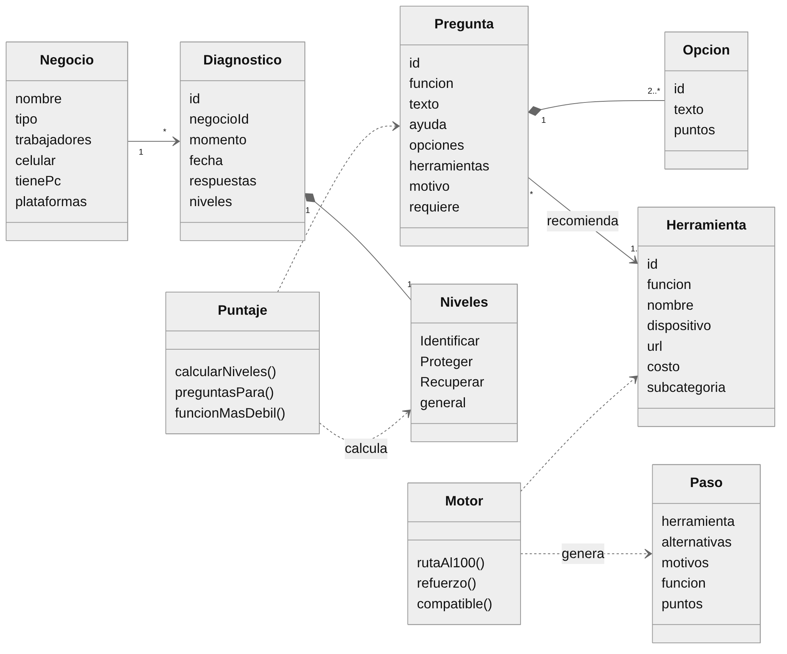

*Fig. 28. Diagrama de tipos y lógica principal. Fuente: elaboración propia.*

### F. Modelo entidad-relación

El modelo se hizo a partir del archivo real de la base de datos. Guarda quién usa la plataforma, qué respondió cada negocio y qué se le recomendó (Fig. 29). El campo «momento» distingue el pre-test del post-test. El diccionario de datos está en el Anexo A.

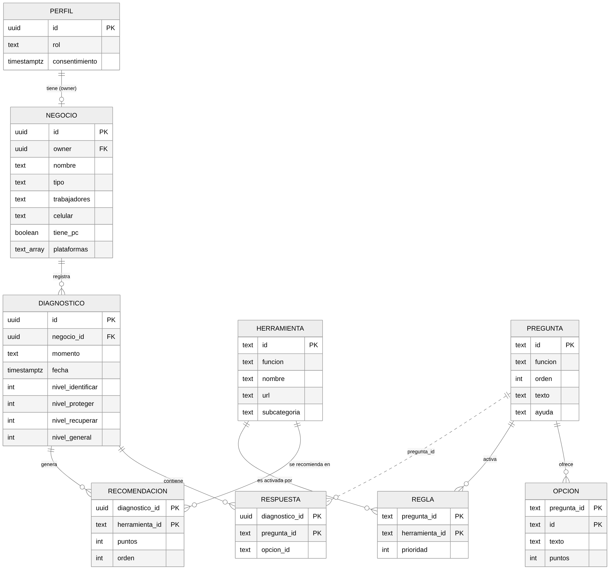

*Fig. 29. Modelo entidad-relación (9 tablas). Fuente: elaboración propia.*

### G. Mapa de navegación y pantallas

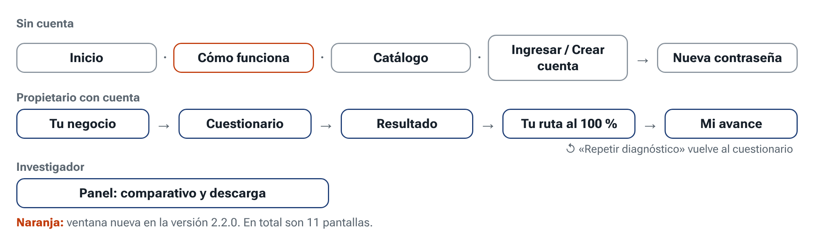

*Fig. 30. Mapa de navegación de la versión 2.2.0. Fuente: elaboración propia.*

Como bocetos se usaron las muestras de pantalla de la sección VI y las de la etapa 2. No se hicieron bocetos en blanco y negro aparte.

**TABLA XII. Pantallas de la plataforma**

| Pantalla | Para qué sirve | Requisitos |
|---|---|---|
| Inicio | Presenta la plataforma y lleva a crear la cuenta. | RNF-03, RNF-09 |
| Cómo funciona (nueva) | Explica los 5 pasos, las 3 funciones, cómo se recomienda y el uso de los datos. | RF-02, RNF-08 |
| Crear cuenta / Ingresar | Registro con correo, contraseña y consentimiento. | RF-16, RNF-08 |
| Nueva contraseña | Crear otra contraseña desde el enlace del correo. | RF-16 |
| Tu negocio | Registra tipo de negocio, equipos y aplicaciones. | RF-17 |
| Cuestionario | Preguntas con explicación; el escudo se llena por función. | RF-01, RF-02, RF-04, RF-15, RNF-04 |
| Resultado | Nivel general y anillos 3D por función. | RF-03, RF-04 |
| Tu ruta al 100 % | Herramientas en orden, con motivo y puntos que suma. | RF-05, RF-07, RF-17 |
| Catálogo | 33 herramientas con búsqueda y filtros. | RF-06 |
| Mi avance | Todos los diagnósticos y cuánto subió el negocio. | RF-16 |
| Panel del investigador | Comparativo antes y después, y descarga en CSV. | Objetivo 4 |

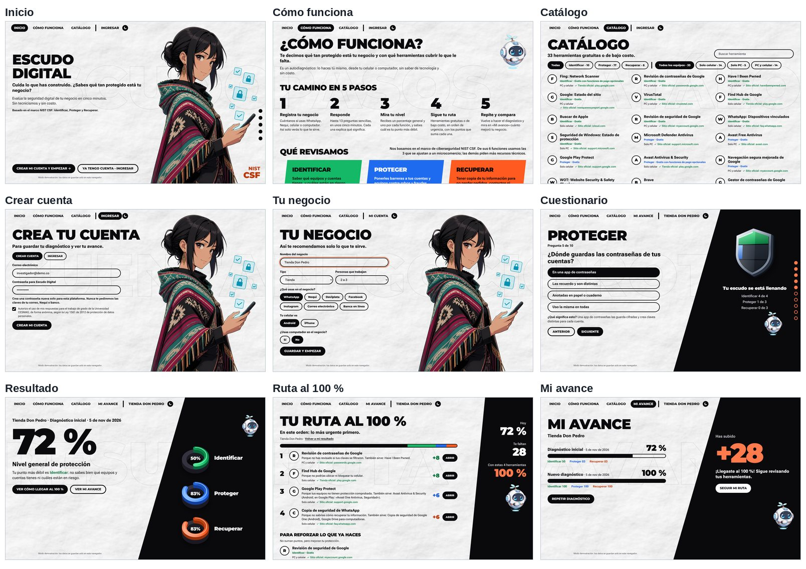

*Fig. 31. Pantallas de la versión 2.2.0 en modo claro. Fuente: elaboración propia.*

## VIII. EVIDENCIA EN GITHUB

Todo el código y la documentación técnica están en el repositorio [15]. Se trabaja en la rama version-2; cada etapa se cierra uniendo a main con un pull request, y al llegar a main la plataforma se publica sola. El historial completo está en el Anexo B.

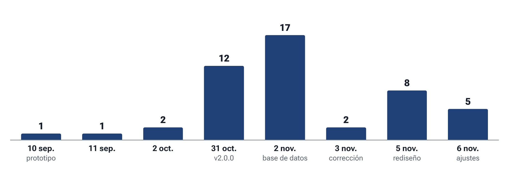

*Fig. 32. Commits por fecha en la rama version-2 (41, sin contar esta documentación). Fuente: historial de Git del repositorio, 5 de noviembre de 2026.*

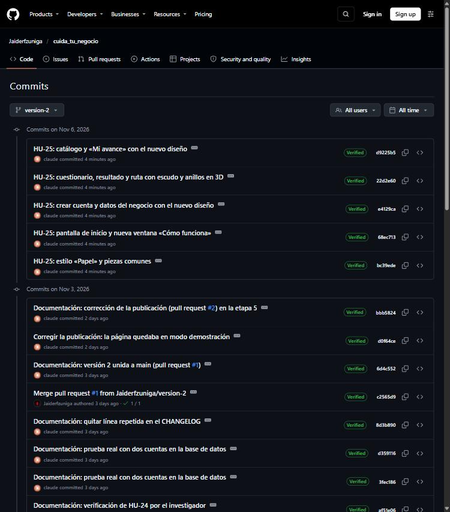

*Fig. 33. Historial de la rama version-2 en GitHub. Fuente: captura de GitHub, 5 de noviembre de 2026 (fechas en hora universal).*

**TABLA XIII. Pull requests del proyecto**

| N.º | Qué une | Abierto | Unido | Tamaño |
|---|---|---|---|---|
| #1 | Versión 2 de la plataforma | 31/10/2026, 00:07 | 02/11/2026, 23:35 | 27 commits, 74 archivos |
| #2 | Corrección del modo demostración | 03/11/2026, 15:44 | 03/11/2026, 15:45 | 2 commits, 4 archivos |
| #3 | Nuevo diseño y documentación | 05/11/2026, 23:12 | 05/11/2026, 23:36 | 9 commits, 64 archivos |
| #4 | Último ajuste de «Tu negocio» y actualización de este informe | 06/11/2026 | Abierto, sin unir | En revisión |

**Tres cosas que conviene tener presentes:**

- **La página pública ya muestra el diseño «Papel»**, desde el 5 de noviembre a las 23:36. El título naranja de «Tu negocio» se publica al unir el pull request #4.
- **La versión anterior no se pierde.** Queda en el commit bbb5824. Las marcas de versión v2.1.3 y v2.2.0 las debe crear el investigador desde su computador, porque el entorno de trabajo no permite enviarlas.
- **Autoría.** En el historial, muchos commits aparecen a nombre de «Claude», el asistente con el que se programó. Los pull requests los unió el investigador.

## IX. CUMPLIMIENTO DE LOS REQUERIMIENTOS

Se revisó el código contra cada requerimiento. «Hecho» significa que está programado; no significa que ya se validó con usuarios. Esta revisión mostró cosas que el tablero no dejaba ver, sobre todo en RF-08, RF-09, RF-10, RF-12, RF-16 y RNF-10.

**TABLA XIV. Requerimientos funcionales**

| ID | La plataforma debe… | Estado | Qué hay hoy |
|---|---|---|---|
| RF-01 | Presentar un cuestionario por funciones | Hecho | 13 preguntas como máximo |
| RF-02 | Explicar cada término técnico | Hecho | Explicación visible en cada pregunta |
| RF-03 | Calcular un nivel por función | Hecho | src/lib/puntaje.ts |
| RF-04 | Mostrar el resultado de forma visual | Hecho | Escudo y anillos en 3D |
| RF-05 | Recomendar con reglas predefinidas | Hecho | src/lib/motor.ts, sin inteligencia artificial |
| RF-06 | Ofrecer catálogo con filtros | Hecho | Por función, equipo y búsqueda |
| RF-07 | Ordenar por prioridad | Hecho | Primero la función con el nivel más bajo |
| RF-08 | Incluir guía paso a paso de respaldo y restauración | Parcial | Descripción y enlace oficial; falta la guía (HU-19) |
| RF-09 | Recomendar una frecuencia de respaldo | Parcial | Pregunta si es automática; no indica una frecuencia (HU-19) |
| RF-10 | Guiar la verificación en dos pasos | Parcial | Recomienda y enlaza; no hay guía propia. Falta el enlace de Nequi (HU-18) |
| RF-11 | Recomendar gestor de contraseñas | Hecho | Pregunta y herramientas de Proteger |
| RF-12 | Enseñar a reconocer fraudes | Parcial | Una pregunta, su explicación y herramientas para revisar enlaces |
| RF-13 | Recomendar protección básica | Hecho | Antivirus y actualizaciones. Falta el enlace de Windows Update (HU-18) |
| RF-14 | Ayudar a inventariar equipos y sesiones | Hecho | Preguntas y herramientas de Identificar |
| RF-15 | Incluir preguntas de conducta | Hecho | Por ejemplo, dónde guarda sus contraseñas |
| RF-16 | Guardar, descargar o imprimir y repetir | Parcial | Guarda, repite y compara; el propietario no puede descargar ni imprimir |
| RF-17 | Adaptarse a las plataformas usadas | Hecho | Filtra preguntas y herramientas |

**TABLA XV. Requerimientos no funcionales**

| ID | Atributo | Estado | Qué hay hoy |
|---|---|---|---|
| RNF-01 | Primero para el celular | Hecho | Probado en tamaño de celular; falta en equipo real (HU-20) |
| RNF-02 | Se usa sin ayuda | Por medir | Pruebas de uso (HU-20) |
| RNF-03 | Acciones simples | Por medir | Botones sin tecnicismos; falta probarlo (HU-20) |
| RNF-04 | Corregir respuestas | Hecho | Botón «Anterior» en el cuestionario |
| RNF-05 | Contraste, texto legible, claro y oscuro | Parcial | Los dos modos existen; falta medir el contraste del diseño nuevo (HU-20) |
| RNF-06 | Fluida con datos móviles | Por medir | Código principal de 119 KB comprimido; falta medir en red móvil |
| RNF-07 | No pedir credenciales reales | Por revisar | Pide solo una contraseña propia; hay que ajustar la redacción |
| RNF-08 | Informar y pedir consentimiento | Hecho | Casilla con fecha guardada; revisar la frase «anónima» |
| RNF-09 | Disponible por enlace | Hecho | GitHub Pages con HTTPS |
| RNF-10 | Actualizar el catálogo sin tocar el código | Parcial | Las pantallas leen el catálogo del código, no de la base de datos |
| RNF-11 | En español y con el glosario | Hecho | Interfaz en español; falta cotejar con el glosario |
| RNF-12 | Autoservicio | Por medir | Pruebas de uso (HU-20) |

## X. TEMAS PARA CONVERSAR CON EL ASESOR

**Para decidir en la revisión:**

1. **Fechas.** Las etapas 1 a 4 quedaron registradas entre el 30 y el 31 de octubre, frente a lo planeado desde el 7 de septiembre. ¿Se presenta así, con el desplazamiento explicado?
2. **Registro retroactivo.** El tablero de las etapas 1 a 4 se escribió después. ¿Es suficiente con declararlo?
3. **Preguntas y puntaje (HU-17).** El código todavía las marca como borrador. Son el paso más urgente, porque de ellas depende la medición.
4. **Congelar el diseño.** Conviene aprobar esta versión y no cambiarla antes de la Fase 4, para que un cambio de pantalla no se mezcle con los resultados.
5. **Requisitos parciales.** RF-08, RF-09, RF-10, RF-12 y RF-16 no se cumplen del todo. ¿Se completan todos en la etapa 6 o se ajusta alguno? RF-16 y RNF-10 no tienen historia de usuario todavía.
6. **Entrar con el nombre del microcomercio.** Le recomendaron entrar con el nombre y una contraseña en lugar del correo. Es posible, pero sin correo no se recupera la contraseña, el nombre debería ser único y sería fácil de adivinar. No se ha cambiado nada.
7. **Frase «de forma anónima».** La plataforma la usa, pero cada cuenta tiene un correo. Se propone decir «sin publicar datos de tu negocio y solo para el trabajo de grado», o lo que el asesor considere.
8. **RNF-07.** Dice «no pedir nunca contraseñas», pero la plataforma pide una propia. Se propone: «no pedir nunca las contraseñas de las cuentas del negocio (correo, Nequi, banco)».

**Para dejar al día:**

1. **Publicación.** El documento de arquitectura dice Vercel y se usa GitHub Pages. Se recomienda dejar GitHub Pages, porque ya funciona, no tiene costo y está ligado al repositorio.
2. **Documento de arquitectura.** Hay que actualizar la fila de identidad visual y pasar de 9 a 11 pantallas.
3. **Imágenes generadas con inteligencia artificial.** Se declaran en la sección VI-E. ¿El programa pide algo más?
4. **Textos del catálogo.** Algunas fichas dicen «funciones de pago opcionales». Se propone unificarlas como «funciones opcionales de bajo costo».
5. **Confirmación del correo.** Supabase pide confirmar el correo antes de entrar. Es más seguro, pero agrega un paso. Se puede revisar con las pruebas de uso.
6. **«Cómo funciona» en el celular.** La página queda larga. Se revisará en las pruebas de uso.

## XI. CONCLUSIONES PARCIALES

1. El objetivo específico 3 avanzó hasta tener una plataforma funcional, con base de datos real y recomendaciones por reglas, pero todavía no está terminado.
2. Scrumban se aplicó en las revisiones y correcciones desde el inicio, y como registro formal desde la etapa 5. El rediseño muestra el ciclo completo: revisión, tarea nueva, propuestas, aplicación, corrección y entrega.
3. NIST CSF mantuvo el alcance: el cuestionario, el puntaje, el catálogo y las recomendaciones siguen limitados a Identificar, Proteger y Recuperar.
4. El cambio de diseño no modificó la lógica de evaluación ni los datos. Su efecto sobre los propietarios aún no se ha medido.
5. La revisión contra los requerimientos dejó siete puntos parciales y varios por medir. Esa lista orienta la etapa 6.

## ANEXO A. DICCIONARIO DE DATOS

Salido del archivo supabase/migrations/001_esquema.sql.

**TABLA XVI. Diccionario de datos**

| Tabla | Campo | Tipo | Qué guarda |
|---|---|---|---|
| perfil | id | uuid (clave) | Cuenta del usuario |
| perfil | rol | texto | propietario o investigador |
| perfil | consentimiento | fecha y hora | Cuándo aceptó el uso de datos (Ley 1581 [16]) |
| perfil | creado | fecha y hora | Cuándo se creó |
| negocio | id | uuid (clave) | Identificador |
| negocio | owner | uuid (único) | Cuenta dueña; una por negocio |
| negocio | nombre, tipo, trabajadores | texto | Datos del microcomercio |
| negocio | celular | texto | android o iphone |
| negocio | tiene_pc | sí/no | Si usa computador |
| negocio | plataformas | lista de texto | WhatsApp, Nequi, etc. |
| negocio | creado | fecha y hora | Cuándo se registró |
| herramienta | id | texto (clave) | Código, como R-05 |
| herramienta | funcion, nombre | texto | Función NIST y nombre |
| herramienta | dispositivo, url, marca | texto | Equipo, enlace oficial y dominio |
| herramienta | costo, uso, rol | texto | Costo, para qué sirve y papel en el catálogo |
| herramienta | espanol | sí/no | Si está en español |
| herramienta | accesibilidad | número | Escala de 1 a 5 |
| herramienta | subcategoria | texto | Subcategoría NIST CSF |
| pregunta | id | texto (clave) | Código, como RC1 |
| pregunta | funcion, texto, ayuda, motivo | texto | Función, enunciado, explicación y frase «porque» |
| pregunta | orden | número | Orden de aparición |
| pregunta | requiere | JSON | Cuándo se muestra |
| opcion | pregunta_id, id | texto (clave) | Pregunta y opción |
| opcion | texto | texto | Lo que se muestra |
| opcion | puntos | número | 0, 1 o 2 |
| regla | pregunta_id, herramienta_id | texto (clave) | Qué herramienta activa cada pregunta |
| regla | prioridad | número | Orden entre alternativas |
| diagnostico | id | uuid (clave) | Identificador |
| diagnostico | negocio_id | uuid | Negocio |
| diagnostico | momento | texto | pre o post |
| diagnostico | fecha | fecha y hora | Cuándo se hizo |
| diagnostico | nivel_identificar, nivel_proteger, nivel_recuperar, nivel_general | número | Niveles de 0 a 100 |
| respuesta | diagnostico_id, pregunta_id | clave | Diagnóstico y pregunta |
| respuesta | opcion_id | texto | Opción elegida |
| recomendacion | diagnostico_id, herramienta_id | clave | Diagnóstico y herramienta |
| recomendacion | puntos, orden | número | Puntos que suma y posición en la ruta |

## ANEXO B. HISTORIAL COMPLETO DE COMMITS

Rama version-2, del más reciente al más antiguo, en hora de Colombia. Se excluye el commit de esta documentación.

**TABLA XVII. Historial de commits**

| Commit | Fecha | Hora | Autor | Mensaje |
|---|---|---|---|---|
| cbf3a61 | 06/11/2026 | 00:10 | Claude | HU-25: título de «Tu negocio» en naranja en modo oscuro |
| d9225b5 | 05/11/2026 | 22:58 | Claude | HU-25: catálogo y «Mi avance» con el nuevo diseño |
| 22d2e60 | 05/11/2026 | 22:58 | Claude | HU-25: cuestionario, resultado y ruta con escudo y anillos en 3D |
| e4129ca | 05/11/2026 | 22:58 | Claude | HU-25: crear cuenta y datos del negocio con el nuevo diseño |
| 68ec713 | 05/11/2026 | 22:58 | Claude | HU-25: pantalla de inicio y nueva ventana «Cómo funciona» |
| bc39ede | 05/11/2026 | 22:58 | Claude | HU-25: estilo «Papel» y piezas comunes |
| bbb5824 | 03/11/2026 | 15:53 | Claude | Documentación: corrección de la publicación (pull request #2) en la etapa 5 |
| d0f64ce | 03/11/2026 | 14:45 | Claude | Corregir la publicación: la página quedaba en modo demostración |
| 6d4c552 | 02/11/2026 | 23:38 | Claude | Documentación: versión 2 unida a main (pull request #1) |
| c2565d9 | 02/11/2026 | 23:35 | Investigador | Merge pull request #1 from Jaiderfzuniga/version-2 |
| 8d3b890 | 02/11/2026 | 23:29 | Claude | Documentación: quitar línea repetida en el CHANGELOG |
| d359116 | 02/11/2026 | 23:17 | Claude | Documentación: prueba real con dos cuentas en la base de datos |
| 3fec186 | 02/11/2026 | 23:15 | Claude | Documentación: prueba real con dos cuentas en la base de datos |
| af51e06 | 02/11/2026 | 23:14 | Claude | Documentación: verificación de HU-24 por el investigador |
| 56d7f63 | 02/11/2026 | 23:01 | Claude | Documentación: CHANGELOG v2.1.2 |
| 42d71cd | 02/11/2026 | 23:01 | Claude | HU-24: el cuestionario ya no queda en blanco y los fallos muestran un mensaje |
| 3f7b99e | 02/11/2026 | 22:52 | Claude | Documentación: HU-24 y CHANGELOG v2.1.1 |
| dbd37f0 | 02/11/2026 | 22:52 | Claude | HU-24: evitar que la plataforma se quede cargando tras iniciar sesión |
| 24c5c31 | 02/11/2026 | 22:41 | Claude | Registrar la primera cuenta real con rol de investigador |
| 441510c | 02/11/2026 | 22:26 | Claude | Documentación: etapa 5 con la base de datos, tablero y CHANGELOG v2.1.0 |
| ba0ebc9 | 02/11/2026 | 22:26 | Claude | HU-21, HU-22, HU-23: consentimiento, recomendaciones guardadas y nueva contraseña |
| 1ca38ed | 02/11/2026 | 22:26 | Claude | HU-16: conectar la base de datos Supabase |
| c0fe7bc | 02/11/2026 | 22:10 | Claude | Documentar cómo se aplica el marco NIST CSF en la plataforma |
| 5365e26 | 02/11/2026 | 22:01 | Claude | Scrumban: redacción más sencilla de las etapas |
| 6df9c17 | 02/11/2026 | 21:57 | Claude | Scrumban: fecha real de la iteración I1 (30/10/2026) |
| 0727747 | 31/10/2026 | 00:34 | Claude | Scrumban: origen de cada historia de usuario y fechas planeadas vs reales |
| ae41f8b | 31/10/2026 | 00:25 | Claude | Documentar la metodología Scrumban: backlog, tablero e iteraciones |
| 834fa3f | 31/10/2026 | 00:11 | Claude | Publicación automática en GitHub Pages |
| d36e85a | 31/10/2026 | 00:05 | Investigador | Corregir referencia al prototipo v1 en el historial de cambios |
| 884a9c1 | 31/10/2026 | 00:05 | Investigador | Documentación: guía de instalación y despliegue, e historial de cambios |
| 1ddd3bc | 31/10/2026 | 00:05 | Investigador | Pantallas: inicio, registro, negocio, cuestionario, resultado, ruta, catálogo, avance y panel |
| 5713fa0 | 31/10/2026 | 00:05 | Investigador | Interfaz: estilos neón, modo claro/oscuro, escudo 3D, anillos animados y logos |
| 4c5e831 | 31/10/2026 | 00:05 | Investigador | Servicios: conexión con Supabase, modo demostración y esquema de base de datos con RLS |
| ede64af | 31/10/2026 | 00:05 | Investigador | Lógica: cálculo del nivel por función y motor de reglas (ruta al 100 % y refuerzo) |
| f428e4b | 31/10/2026 | 00:05 | Investigador | Datos: catálogo de 33 herramientas y cuestionario por función NIST CSF |
| 8f4d84c | 31/10/2026 | 00:05 | Investigador | Estructura del proyecto: Vite, React, TypeScript y Tailwind |
| a7298f7 | 31/10/2026 | 00:05 | Investigador | Retirar el prototipo v1 para dar paso a la versión 2 |
| 5173086 | 02/10/2026 | 23:49 | Investigador | Actualizar la estructura del README y agregar guía de instalación |
| 2f0e9ed | 02/10/2026 | 23:14 | Investigador | Initialize README with project details and setup instructions |
| 954d303 | 11/09/2026 | 16:34 | Investigador | feat(ui): actualiza dependencias, vite config y optimiza logica de diagnostico con links de descarga |
| 24b2ac2 | 10/09/2026 | 19:15 | Investigador | Configuracion inicial para deploy |

## REFERENCIAS

[1] K. Schwaber y J. Sutherland, «The Scrum Guide: The Definitive Guide to Scrum: The Rules of the Game», nov. 2020. [En línea]. Disponible en: https://scrumguides.org/scrum-guide.html

[2] C. Ladas, Scrumban: Essays on Kanban Systems for Lean Software Development. Seattle, WA, EE. UU.: Modus Cooperandi Press, 2009.

[3] National Institute of Standards and Technology, «The NIST Cybersecurity Framework (CSF) 2.0», NIST CSWP 29, Gaithersburg, MD, EE. UU., feb. 2024, doi: 10.6028/NIST.CSWP.29.

[4] International Organization for Standardization, ISO/IEC 25010:2023 Systems and software engineering — Systems and software Quality Requirements and Evaluation (SQuaRE) — Product quality model. Ginebra, Suiza: ISO, 2023.

[5] Anthropic, «Claude», 2026. [En línea]. Disponible en: https://claude.ai

[6] Canva, «Canva», 2026. [En línea]. Disponible en: https://www.canva.com

[7] Google, «Gemini», 2026. [En línea]. Disponible en: https://gemini.google.com

[8] GitHub, «GitHub Pages documentation». [En línea]. Disponible en: https://docs.github.com/pages

[9] Meta Open Source, «React: The library for web and native user interfaces», documentación oficial. [En línea]. Disponible en: https://react.dev

[10] Microsoft, «TypeScript Documentation». [En línea]. Disponible en: https://www.typescriptlang.org/docs/

[11] Vite, «Vite: Next Generation Frontend Tooling», documentación oficial. [En línea]. Disponible en: https://vite.dev

[12] Tailwind Labs, «Tailwind CSS Documentation». [En línea]. Disponible en: https://tailwindcss.com/docs

[13] Remix Software, «React Router», documentación oficial. [En línea]. Disponible en: https://reactrouter.com

[14] Supabase, «Supabase Docs». [En línea]. Disponible en: https://supabase.com/docs

[15] J. F. Matta Zuñiga, «cuida_tu_negocio: Escudo Digital v2», repositorio GitHub, rama version-2, 2026. [En línea]. Disponible en: https://github.com/Jaiderfzuniga/cuida_tu_negocio

[16] Congreso de la República de Colombia, «Ley Estatutaria 1581 de 2012, por la cual se dictan disposiciones generales para la protección de datos personales», Diario Oficial n.º 48.587, 18 oct. 2012.
