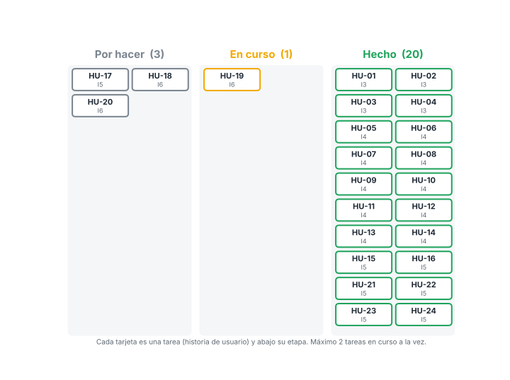

# Metodología Scrumban — Escudo Digital

El desarrollo de la plataforma (objetivo específico 3) se gestiona con **Scrumban**: las iteraciones con revisión de Scrum y el tablero con límite de trabajo de Kanban.

## Cómo se aplica

| Elemento | En este proyecto |
|---|---|
| Dueño del producto | Jaider Felipe Matta Zúñiga (investigador): prioriza el backlog según el diagnóstico (OE1) y el catálogo (OE2) |
| Equipo de desarrollo | El investigador, con apoyo de asistentes de IA para programación y documentación |
| Interesados | Asesor y los propietarios de microcomercios |
| Backlog | Historias de usuario (HU) enlazadas a los requisitos RF/RNF → [backlog.md](backlog.md) |
| Tablero | Por hacer → En curso → Hecho, con **límite de 2 HU en curso** |
| Iteraciones | 6 iteraciones (I1–I6) dentro de las actividades 7, 8 y 9 del cronograma → [iteraciones.md](iteraciones.md) |
| Revisión | Al cerrar cada iteración, el investigador prueba la plataforma y registra correcciones |
| Retrospectiva | Una mejora del proceso por iteración (columna «Mejora» en iteraciones.md) |
| Trazabilidad | Cada HU terminada se sube en un commit que menciona su código (ej.: `HU-16: conectar Supabase`); se trabaja en `version-2` y cada etapa se cierra con un pull request hacia `main` |

## Definición de hecho

Una historia de usuario pasa a **Hecho** cuando:
1. Cumple el requisito RF/RNF enlazado y está dentro del alcance (Identificar, Proteger, Recuperar).
2. Compila sin errores y las pruebas automáticas pasan (`npm test`).
3. Se probó en celular y en computador, en modo claro y oscuro.
4. Se probaron los casos extremos (todas las respuestas «sí» y todas «no»).
5. Está subida a GitHub y registrada en el CHANGELOG.

## Avance actual

**21 de 25 historias hechas**, 1 en curso y 3 por hacer (5 de noviembre de 2026).

