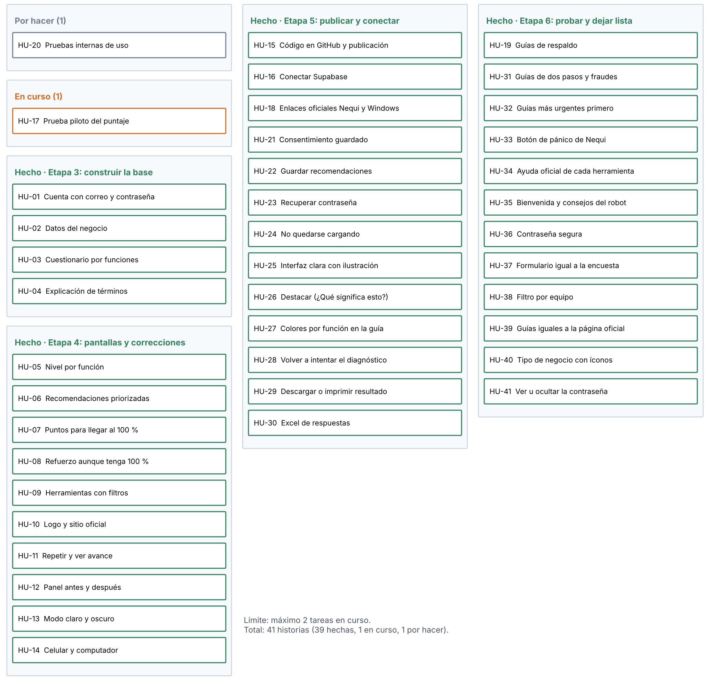

# Scrumban: cómo se organizó el trabajo

La plataforma (objetivo 3) se construyó con **Scrumban**: de Scrum se tomaron las etapas que terminan con una revisión, y de Kanban el tablero con un máximo de tareas en curso. Se eligió porque la hizo una sola persona: Scrum completo pide roles y reuniones diarias que no tienen sentido para un equipo de uno, y Kanban solo no da momentos fijos para revisar.

## Cómo se usó

| Elemento | En este proyecto |
|---|---|
| Dueño del producto | Jaider Felipe Matta Zuñiga (investigador): decide qué se hace primero, según el diagnóstico (objetivo 1) y el catálogo (objetivo 2) |
| Equipo de desarrollo | El investigador |
| Interesados | El asesor y los propietarios de los microcomercios |
| Backlog | Historias de usuario (HU) enlazadas a los requisitos RF/RNF → [backlog.md](backlog.md) |
| Tablero | Por hacer → En curso → Hecho, con **límite de 2 HU en curso** |
| Iteraciones | 6 etapas (I1 a I6), sacadas de las actividades 7, 8 y 9 del cronograma → [iteraciones.md](iteraciones.md) |
| Revisión | Al cerrar cada etapa, el investigador prueba la plataforma y anota qué corregir |
| Retrospectiva | Una mejora del proceso por etapa (columna «Mejora» en iteraciones.md) |
| Trazabilidad | Cada HU terminada se sube en un commit que menciona su código (ej.: `HU-16: conectar Supabase`); se trabaja en `version-2` y cada etapa se cierra con un pull request hacia `main` |

## Definición de hecho

Una historia de usuario pasa a **Hecho** cuando:
1. Cumple el requisito RF/RNF enlazado y está dentro del alcance (Identificar, Proteger, Recuperar).
2. Compila sin errores y las pruebas automáticas pasan (`npm test`).
3. Se probó en celular y en computador, en modo claro y oscuro.
4. Se probaron los casos extremos (todas las respuestas «sí» y todas «no»).
5. Está subida a GitHub y registrada en el CHANGELOG.

## Cómo va

**41 historias: 39 hechas, 1 en curso (HU-17, prueba piloto del puntaje) y 1 por hacer (HU-20, pruebas internas de uso)**, al 20 de noviembre de 2026.

> Las etapas 1 a 4 se anotaron en el tablero después de hechas, el 31 de octubre: tuvieron planeación y revisión, pero no se llevaron con el tablero mientras pasaban. Desde la etapa 5 el método se usó a medida que se trabajaba.
